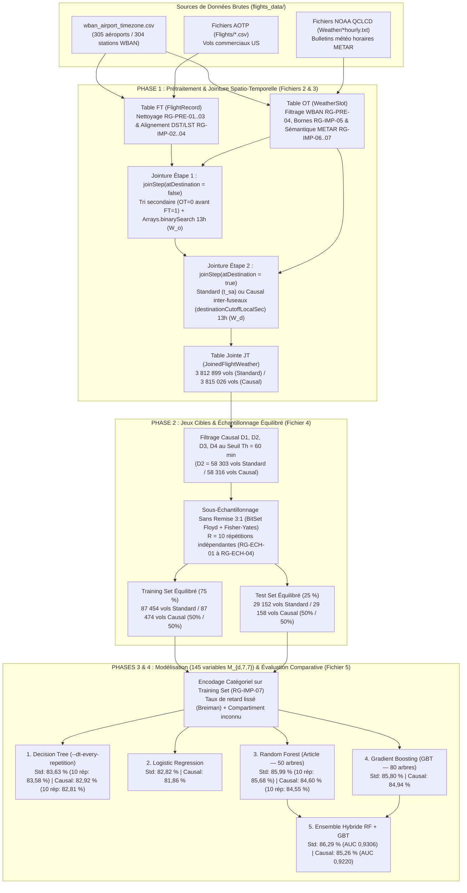
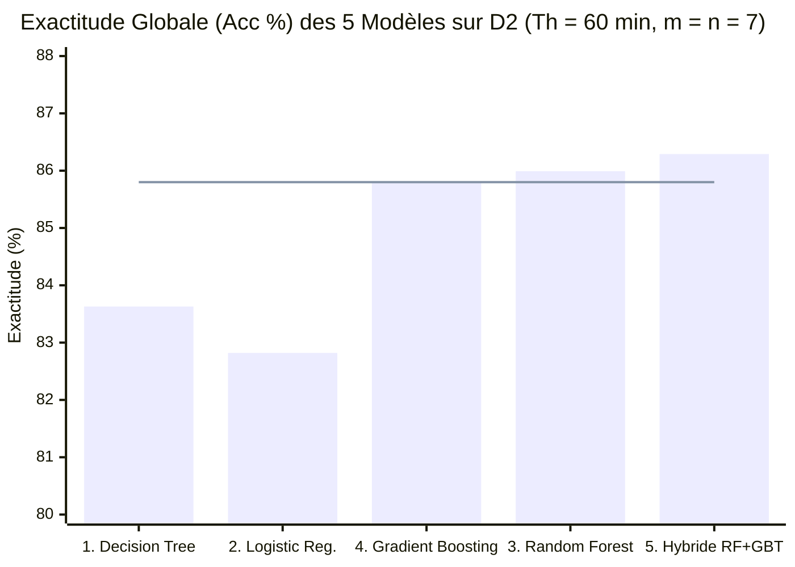
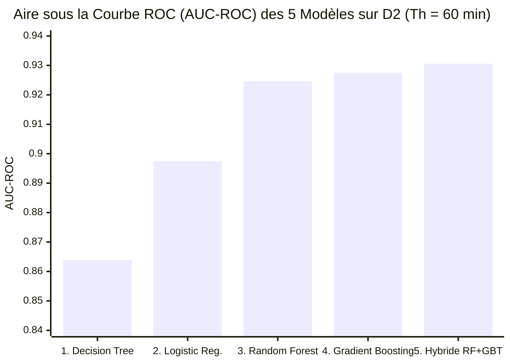
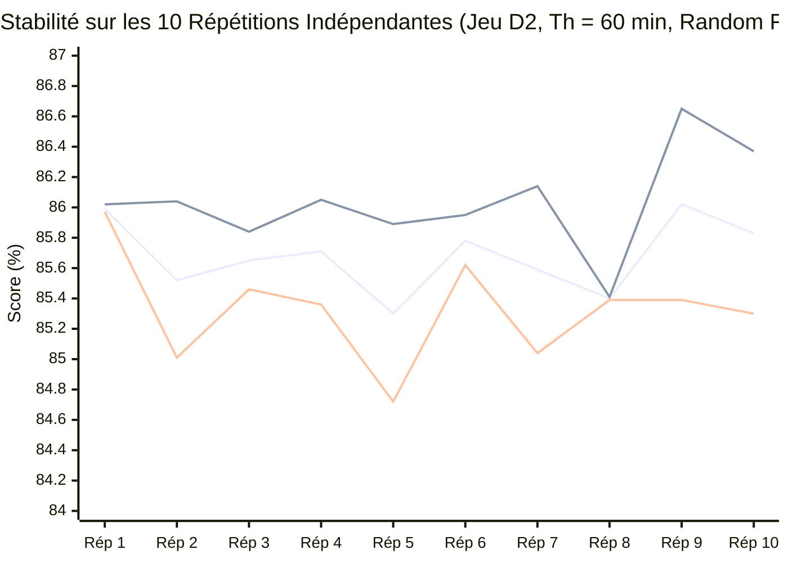
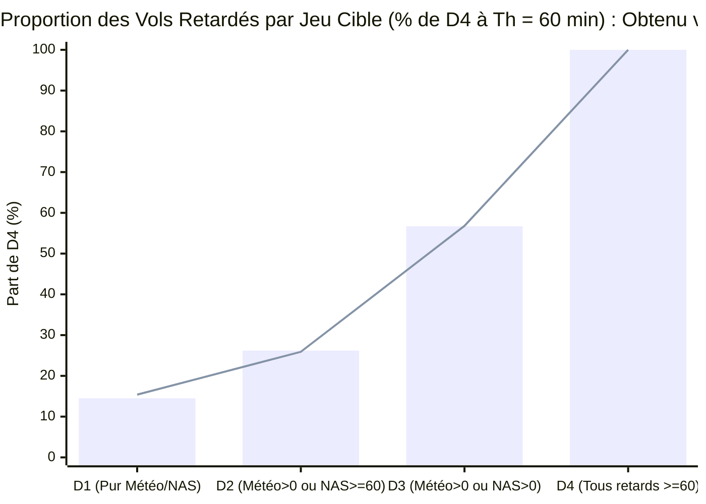

# Spécification Fonctionnelle et Technique : Système Prédictif des Retards de Vols (TIST-Flight-Delay)

### **Executive Master IA et Sciences des données - Big Data - Année universitaire 2026 - Réalisé par Frédéric Delcroix - Xuan Peng et Issam Yousr**

---

## Table des Matières

- **1. Contexte, Objet et Périmètre Opérationnel**
  - 1.1 Finalité Métier et Cas d'Usage
  - 1.2 Positionnement par Rapport aux Systèmes Existants et Limites de Périmètre
- **2. Modèle de Données et Définitions Formelles**
  - 2.1 Définition Formelle d'un Vol Historique `F` et d'un Vol Programmé en Inférence `F_s`
  - 2.2 Définition Formelle d'une Observation Météorologique `O`
  - 2.3 Calcul du Retard à l'Arrivée et Classification Binaire (`RG-DEF-01` à `RG-DEF-03`)
- **3. Prétraitement et Nettoyage des Sources de Données**
  - 3.1 Spécifications Volumétriques des Sources Entrantes
  - 3.2 Règles d'Assainissement des Données de Vol — Table FT (`RG-PRE-01` à `RG-PRE-03`)
  - 3.3 Règles d'Assainissement des Données Météorologiques — Table OT (`RG-PRE-04` et `RG-PRE-05`)
- **4. Règles de Gestion des Causes de Retard et Jeux Cibles**
  - 4.1 Taxonomie des Cinq Grandes Catégories du BTS (`RG-CAU-01`)
  - 4.2 Décomposition Multi-Causes Détaillée (Figure 1)
  - 4.3 Spécifications des Jeux de Données Cibles `D1`, `D2`, `D3`, `D4` (`RG-CIB-01` à `RG-CIB-04`)
- **5. Règles d'Enrichissement et de Jointure Spatio-Temporelle**
  - 5.1 Structure du Tuple de Données Conjointes `JT`
  - 5.2 Algorithme de Jointure par Répartition Améliorée — MapReduce / Algorithme 1 (`RG-JNT-01` à `RG-JNT-06`)
- **6. Règles d'Équilibrage des Classes et Protocole d'Échantillonnage**
  - 6.1 Protocole de Sous-Échantillonnage Aléatoire Sans Remise — Figure 4 (`RG-ECH-01` à `RG-ECH-04`)
- **7. Règles de Modélisation Prédictive et d'Inférence**
  - 7.1 Implémentation Distribuée du Random Forest (Figure 5)
  - 7.2 Vecteur d'Entrée du Prédicteur et Famille de Modèles `M_{d, m, n}` (`RG-MOD-01` à `RG-MOD-04`)
- **8. Règles d'Évaluation, Métriques et Critères d'Acceptation**
  - 8.1 Matrice de Confusion Binaire (Tableau II)
  - 8.2 Formules Normalisées de Performance (`Acc`, `Rec_o`, `Rec_d`, `AUC-ROC`)
  - 8.3 Seuils d'Acceptation et Résultats Empiriques de Référence (`RG-VAL-01` à `RG-VAL-04`)
  - 8.4 Exigences d'Évolutivité de l'Infrastructure Distribuée (Tableau IX & Figure 10)
- **9. Raffinements Techniques d'Implémentation Apache Spark (Confrontation aux Données Réelles)**
  - 9.1 Harmonisation des Fuseaux Horaires — Heure Civile DST vs Heure Standard LST (`RG-IMP-01` et `RG-IMP-02`)
  - 9.2 Reconstruction de `t_{sa}` (`CRS_ARR_TIME`) et Normalisation de `"2400"` (`RG-IMP-03` et `RG-IMP-04`)
  - 9.3 Typage Strict, Bornes Physiques et Sémantique METAR dans QCLCD (`RG-IMP-05` et `RG-IMP-06`)
  - 9.4 Encodage des Variables Catégorielles à Haute Cardinalité dans Spark ML (`RG-IMP-07`)
  - 9.5 Variante Méthodologique : Jointure Strictement Causale Anti-Fuite Temporelle `C01 / F04` (`RG-IMP-08`)
- **10. Architecture d'Implémentation Scala / Apache Spark (7 Fichiers)**
  - 10.1 Diagramme d'Architecture et Flux de Données du Pipeline
  - 10.2 Table de Traçabilité Exhaustive entre les 7 Fichiers Scala et les 39 Règles de Gestion (`RG-*`)
- **11. Résultats Expérimentaux Complets sur `flights_data` (10 Répétitions & 5 Modèles)**
  - 11.1 Volumétrie Réelle Observée et Validation du Tableau VI (`Th = 60 min`)
  - 11.2 Résultats Détaillés des 10 Répétitions Indépendantes (`RG-ECH-04` — Random Forest & Decision Tree `M_{D2, 7, 7}`)
  - 11.3 Banc d'Essai Comparatif des 5 Modèles de Machine Learning
  - 11.4 Analyse Critique de la Causalité Temporelle : Mode Standard (`STANDARD_BELCASTRO`) vs Mode Causal Strict Anti-Fuite (`STRICT_CAUSAL_C01_F04` — Règle `RG-IMP-08`)
- **12. Graphiques Récapitulatifs et Visualisations des Performances**
  - 12.1 Graphique 1 : Comparaison de l'Exactitude (`Acc`) et du Rappel des Retards (`Rec_d`) des 5 Modèles
  - 12.2 Graphique 2 : Comparaison de l'Aire sous la Courbe ROC (`AUC-ROC`) des 5 Modèles
  - 12.3 Graphique 3 : Stabilité des Performances sur les 10 Répétitions Indépendantes (`RG-ECH-04`)
  - 12.4 Graphique 4 : Fidélité Volumétrique des Jeux Cibles `D1`, `D2`, `D3`, `D4` (Résultats vs Article)
  - 12.5 Graphique 5 : Répartition du Temps de Calcul par Phase du Pipeline (Tableau IX)
  - 12.6 Annexe : Commandes d'Exécution et Journaux Console Intégraux (`STANDARD_BELCASTRO` & `STRICT_CAUSAL`)
- **13. Retour d'Expérience d'Ingénierie : Les 5 Défis Majeurs du Projet et leurs Solutions**
  - 13.1 Défi n°1 (Architecture Big Data) : Jointure Spatio-Temporelle Distribuée de 3,81 Millions de Vols avec 26 Bulletins Météo
  - 13.2 Défi n°2 (Alignement Temporel sur Données Réelles) : Décalage d'Heure d'Été (`DST` vs `LST`) et Reconstruction de `t_{sa}`
  - 13.3 Défi n°3 (Qualité des Données METAR & Spark MLlib) : Nettoyage Lexical QCLCD et Contournement de `maxBins = 128`
  - 13.4 Défi n°4 (Passage à l'Échelle) : Échantillonnage Équilibré Sans Remise sur 10 Répétitions sans Transfert Réseau (*Zero-Shuffle Sampling*)
  - 13.5 Défi n°5 (Recul Critique Scientifique) : Identification et Correction de la Fuite Temporelle sur la Météo d'Arrivée (`STRICT_CAUSAL`)
  - 13.6 Synthèse Exécutive des Verrous Résolus

---


## 1. Contexte, Objet et Périmètre Opérationnel

Le présent document constitue le référentiel d'exigences et de spécifications fonctionnelles et techniques formalisant l'ensemble des règles de gestion implémentées dans l'architecture prédictive Big Data documentée dans l'étude scientifique *Utilisation de l’exploration de données évolutive pour prédire les retards de vol* (Belcastro et al., *ACM Transactions on Intelligent Systems and Technology*, 2016). Ce système déploie des algorithmes d'apprentissage automatique parallèles sur une infrastructure distribuée en nuage (*Cloud computing*) régie par le modèle de programmation MapReduce / Apache Spark.

### 1.1 Finalité Métier et Cas d'Usage

L'objectif central du système est d'estimer avec un haut niveau de fiabilité, plusieurs jours à l'avance, le retard à l'arrivée d'un vol commercial régulier individuel causé par les conditions météorologiques. Les prédictions générées sont destinées à enrichir des services opérationnels à destination de quatre catégories d'acteurs de l'écosystème aérien :

* **Passagers individuels :** Estimation anticipée du risque de retard à l'arrivée afin d'adapter les correspondances critiques sur des vols directs ou multi-escales, où un retard isolé peut compromettre ou annuler l'ensemble du voyage.

* **Compagnies aériennes :** Anticipation des perturbations induites par la météo pour ajuster les plannings opérationnels, optimiser les rotations d'appareils et réviser les grilles horaires afin de résorber les retards structurels chroniques.

* **Gestionnaires aéroportuaires et régulation du trafic :** Outil d'aide à la décision pour le dimensionnement des capacités de piste et la gestion des flux d'avions à l'arrivée.

* **Plateformes de réservation de vols :** Moteur de recommandation capable de préconiser les itinéraires et créneaux horaires présentant la plus haute probabilité de ponctualité.

### 1.2 Positionnement par Rapport aux Systèmes Existants et Limites de Périmètre

Le système se distingue fondamentalement du modèle de référence de la Federal Aviation Administration (FAA) basé sur l'indice WITI (*Weather Impacted Traffic Index*). Alors que l'indice WITI modélise un volume global de retard agrégé à l'échelle d'une plateforme aéroportuaire entière en croisant les conditions météo et l'engorgement du trafic en files d'attente, l'architecture spécifiée ci-après réalise une inférence unitaire à l'échelle du vol individuel en combinant son plan de vol et les chroniques météorologiques locales.

Les choix d'ingénierie imposent trois délimitations strictes du périmètre de modélisation :

* **Exclusion des conditions météorologiques en cours de route :** Les observations atmosphériques relatives à la phase de vol en altitude de croisière sont exclues. La fusion des mesures au sol le long de trajectoires tridimensionnelles variables et l'impact de l'altitude introduisent un degré d'incertitude disproportionné par rapport au pouvoir prédictif des conditions aux aérodromes terminaux.

* **Exclusion de la propagation des retards d'aéronefs précédents :** Les retards imputables aux arrivées tardives d'avions (*Late Aircraft Delays*) issus de liaisons antérieures sont écartés des données cibles météorologiques privilégiées ($D_1, D_2$). Ces phénomènes relèvent d'une dynamique de propagation réticulaire en cascade et non de l'impact direct du climat instantané aux aéroports d'origine et de destination.

* **Filtrage opérationnel des vols :** Seuls les vols réguliers intérieurs effectivement opérés jusqu'à leur destination prévue sont traités. Les vols annulés et les vols déroutés font l'objet d'un élagage systématique.

## 2. Modèle de Données et Définitions Formelles

Le système repose sur des structures de données formellement définies issues de l'appariement d'enregistrements aéronautiques et météorologiques standardisés.

### 2.1 Définition Formelle d'un Vol Historique ($F$) et d'un Vol Programmé en Inférence ($F_s$)

Un vol historique complet, désigné par la variable $F$, est modélisé par un sextuplet représentant ses coordonnées géographiques d'exploitation et ses jalons temporels programmés et réels :

$$
F = \langle A_o, A_d, t_{sd}, t_{ad}, t_{sa}, t_{aa} \rangle
$$

Les attributs constitutifs de ce tuple sont définis selon la nomenclature suivante :

* $A_o$ : Aérodrome de départ ou d'origine (*Airport of origin*).

* $A_d$ : Aérodrome d'arrivée ou de destination (*Airport of destination*).

* $t_{sd}$ : Horodatage planifié du départ du vol (*Scheduled departure time*).

* $t_{ad}$ : Horodatage effectif du départ du vol (*Actual departure time*).

* $t_{sa}$ : Horodatage planifié de l'arrivée à la porte d'embarquement (*Scheduled arrival gate time*).

* $t_{aa}$ : Horodatage effectif de l'arrivée à la porte d'embarquement (*Actual arrival gate time*).

Chaque variable temporelle intègre obligatoirement la composante calendaire complète (année, mois, jour) ainsi que la composante horaire précise (heures et minutes).

En phase de prédiction opérationnelle (avant le vol), les heures effectives $t_{ad}$ et $t_{aa}$ sont inconnues. Un **vol programmé**, désigné par $F_s$, est donc formellement restreint au quadruplet :

$$
F_s = \langle A_o, A_d, t_{sd}, t_{sa} \rangle
$$

### 2.2 Définition Formelle d'une Observation Météorologique ($O$)

Une observation météorologique locale aéroportuaire, désignée par la variable $O$, est modélisée par un décuplet physique conforme aux relevés horaires de type METAR :

$$
O = \langle A, t, T, H, W_d, W_s, P, S, V, D \rangle
$$

Les dimensions physiques et descriptives associées sont :

* $A$ : Identifiant de la plateforme aéroportuaire hôte de la station de mesure.

* $t$ : Horodatage précis du relevé météorologique (date, heure, minute).

* $T$ : Température ambiante enregistrée.

* $H$ : Humidité relative de l'air.

* $W_d$ : Direction du vent (*Wind direction*).

* $W_s$ : Vitesse scalaire du vent (*Wind speed*).

* $P$ : Pression barométrique locale (*Station pressure*).

* $S$ : État du ciel et couverture nuageuse (*Sky condition*).

* $V$ : Portée visuelle horizontale (*Visibility*).

* $D$ : Descripteur qualitatif des phénomènes météorologiques observés (format METAR avec qualificatifs d'intensité ou de proximité, tels que `+SN` pour de fortes chutes de neige ou `TSGR` pour un orage accompagné de grêle).

### 2.3 Calcul du Retard à l'Arrivée et Classification Binaire

Le calcul du retard réel à l'arrivée et la labellisation des instances sont gouvernés par des règles arithmétiques et de seuillage univoques.

La métrique $AD(F)$ quantifie l'écart temporel constaté à l'atterrissage et à l'accostage à la porte par rapport à la programmation théorique du transporteur :

$$
AD(F) = F.t_{aa} - F.t_{sa}
$$

La notation pointée ($F.t_{aa}$) désigne l'accès aux variables respectives du tuple $F$.

L'affectation de la classe d'état du vol est déterminée selon un seuil paramétrique de retard, désigné par $Th$ (*Threshold*) :

* **Règle RG-DEF-01 (Classification d'un vol à l'heure) :** Pour un vol $F$ et un seuil de retard $Th$ donné, le vol est formellement classifié comme étant « À l'heure » (*On-Time*, classe `0.0`) si et seulement si son retard à l'arrivée est strictement inférieur à la valeur du seuil :

$$
AD(F) < Th
$$

* **Règle RG-DEF-02 (Classification d'un vol en retard) :** Pour un vol $F$ et un seuil de retard $Th$ donné, le vol est formellement classifié comme étant « En retard » (*Delayed*, classe `1.0`) si et seulement si son retard à l'arrivée est supérieur ou égal à la valeur du seuil :

$$
AD(F) \ge Th
$$

* **Règle RG-DEF-03 (Seuils opérationnels admissibles et validation de la configuration) :** Le système supporte une plage discrète de cinq seuils de retard :

$$
Th \in \lbrace 15, 30, 45, 60, 90 \rbrace \text{ minutes}
$$

Le seuil réglementaire pivot de la FAA établissant le retard légal d'un vol commercial correspond à $Th = 15$ minutes. Dans le code (`PipelineConfig`), cette règle ainsi que la validité de tous les paramètres (`targetDataset` $\in \lbrace \text{D1, D2, D3, D4} \rbrace$, $m, n \in [0, 13]$, `repetitions >= 1`, `numJoinPartitions >= 1`, `numTrees >= 1`, `maxDepth` $\in [1, 30]$, `maxBins >= 2`) sont contrôlées systématiquement par des assertions `require(...)` à chaque création ou copie immuable de la configuration.

## 3. Prétraitement et Nettoyage des Sources de Données

Le système ingère deux flux de données ouvertes massives couvrant une profondeur temporelle de cinq années complètes, du 1er janvier 2009 au 31 décembre 2013.

### 3.1 Spécifications Volumétriques des Sources Entrantes

La volumétrie globale des sources requiert des capacités de stockage et de traitement distribuées. Le tableau ci-dessous détaille la volumétrie brute, le volume de tuples et le schéma relationnel des jeux de données d'entrée (Tableau I de l'article) :

| Source de données | Organisme émetteur | Taille brute | Nombre de tuples | Colonnes | 
| ----- | ----- | ----- | ----- | ----- | 
| **AOTP** (*Airline On-Time Performance*) | BTS / RITA | 13,37 Go | 31 millions | 109 colonnes | 
| **QCLCD** (*Quality Controlled Local Climatological Data*) | NCDC (NOAA) | 27,68 Go | 233 millions | 44 colonnes | 

Le jeu AOTP recense l'intégralité des vols intérieurs américains opérés par les transporteurs majeurs, fournissant les éléments d'horodatage, les temps de vol, les distances sans escale et les causes de retard déclarées. Le jeu QCLCD collecte les relevés météorologiques horaires issus d'environ 1 600 stations américaines officielles.

### 3.2 Règles d'Assainissement des Données de Vol (Table FT)

La construction de la table pivot des vols ($FT$ pour *Flight Table*, implémentée dans `DataPreprocessor.loadAndCleanFlightTable` et `parseFlightRow`) applique des filtres d'exclusion stricts visant à éliminer les vols non exploitables pour la modélisation des retards :

* **Règle RG-PRE-01 (Élagage des vols annulés) :** Tout vol catégorisé comme « Annulé » (`CANCELLED != 0.0`), ainsi que tout enregistrement dont l'indicateur `CANCELLED` est manquant ou illisible (`parseDouble(col(5), Double.NaN) != 0.0`), est immédiatement supprimé du pipeline d'apprentissage. Ces vols représentent historiquement entre 1,3 % et 1,9 % du volume annuel de l'ensemble AOTP.

* **Règle RG-PRE-02 (Élagage des vols déroutés) :** Tout vol dont la trajectoire a été modifiée en cours d'opération (`DIVERTED != 0.0`), ainsi que tout enregistrement dont l'indicateur `DIVERTED` est manquant ou illisible (`parseDouble(col(6), Double.NaN) != 0.0`), est exclu de la table $FT$ (car $AD(F) = F.t_{aa} - F.t_{sa}$ n'y est pas défini). Ces vols représentent environ 0,2 % du volume annuel.

* **Règle RG-PRE-03 (Détection des anomalies et complétude temporelle) :** Tout enregistrement présentant des anomalies structurelles, des incohérences de format ou des valeurs manquantes est écarté lors du prétraitement (`parseFlightRow` renvoie `null`) si l'une des conditions suivantes n'est pas remplie :
  * Les identifiants `ORIGIN_AIRPORT_ID` et `DEST_AIRPORT_ID` doivent tous deux exister dans le référentiel des aéroports (`airportsById.contains(...)`).
  * La date du vol `FL_DATE` (`AAAA-MM-JJ`) et l'heure de départ prévue `CRS_DEP_TIME` (`HHmm`, avec `"2400"` autorisé) doivent être valides (`flDate != null` et `crsDepMin >= 0`).
  * Le retard à l'arrivée `ARR_DELAY_NEW` doit être présent, fini et positif ou nul (`arrDelay != -999.0 && !arrDelay.isNaN && !arrDelay.isInfinite && arrDelay >= 0.0`).
  * La durée prévue du vol `CRS_ELAPSED_TIME` doit être présente, finie et strictement positive (`crsElapsed > 0.0 && !crsElapsed.isNaN && !crsElapsed.isInfinite`).
  * En outre, lors de la lecture locale d'un répertoire `Flights/*.csv`, `resolveMatchingFlightFiles` ne charge que les fichiers mensuels de vols pour lesquels un fichier mensuel météo `AAAAMMhourly.txt` correspondant est présent.

La distribution annuelle de référence des vols commerciaux au sein de la base brute AOTP s'établit selon le tableau ci-après (Tableau III de l'article) :

| Année | Total des vols | % Vols à l'heure ($<15$ min) | % Vols retardés ($\ge 15$ min) | % Vols annulés | % Vols déroutés | 
| ----- | ----- | ----- | ----- | ----- | ----- | 
| **2009** | 6 450 285 | 79,5 % | 18,9 % | 1,4 % | 0,2 % | 
| **2010** | 6 450 117 | 79,8 % | 18,2 % | 1,8 % | 0,2 % | 
| **2011** | 6 085 281 | 79,6 % | 18,2 % | 1,9 % | 0,2 % | 
| **2012** | 6 096 762 | 81,9 % | 16,7 % | 1,3 % | 0,2 % | 
| **2013** | 6 369 482 | 78,3 % | 19,9 % | 1,5 % | 0,2 % | 

### 3.3 Règles d'Assainissement des Données Météorologiques (Table OT)

La construction de la table des observations météorologiques valides ($OT$ pour *Observation Table*, implémentée dans `DataPreprocessor.loadAndCleanObservationTable` et `parseWeatherRow`) filtre l'ensemble QCLCD pour ne retenir que les stations et attributs pertinents :

* **Règle RG-PRE-04 (Filtrage spatial des stations aéroportuaires) :** Toutes les stations d'observation météo (`WBAN`) non associées au code officiel d'un aérodrome présent dans la table de référence `wban_airport_timezone.csv` sont supprimées (`airportsByWban.getOrElse(..., Array.empty)`). Lorsqu'une même station `WBAN` couvre plusieurs aéroports (relation $1\text{-}N$ gérée par `groupBy(_.wban)` et `.flatMap`), le bulletin est émis pour chacun des aéroports rattachés.

* **Règle RG-PRE-05 (Sélection et normalisation des 8 attributs de** $O$**) :** Seules les 3 colonnes d'identification spatio-temporelle (`WBAN`, `Date` au format `AAAAMMJJ`, `Time` au format `HHmm` avec `"2400"` interdit), les 6 attributs numériques (`DryBulbFarenheit`, `RelativeHumidity`, `WindDirection`, `WindSpeed`, `StationPressure`, `Visibility`) et les 2 descripteurs qualitatifs METAR (`SkyCondition`, `WeatherType`) sont extraits et normalisés dans `WeatherSlot` (en comptant également `missingCount` $\in [0, 8]$, le nombre d'attributs manquants du bulletin).

## 4. Règles de Gestion des Causes de Retard et Jeux Cibles

La réglementation du BTS en vigueur depuis juin 2003 impose aux compagnies aériennes de catégoriser les causes fondamentales des retards supérieurs ou égaux à 15 minutes selon cinq classes normées.

### 4.1 Taxonomie des Cinq Grandes Catégories du BTS

Les retards subis par les vols sont ventilés entre les causes suivantes :

1. **Compagnie aérienne / Transporteur (*Carrier* - C) :** Causes relevant de la maîtrise directe de la compagnie (maintenance d'aéronef, indisponibilité d'équipage, nettoyage de cabine, manutention des bagages, approvisionnement en carburant).

2. **Arrivée tardive de l'avion (*Late Aircraft* - L) :** Retard généré au départ par l'arrivée décalée de l'appareil affecté à la liaison lors de sa rotation précédente.

3. **Système national de navigation aérienne (*NAS* - N) :** Retards imputables à l'exploitation globale de l'espace aérien régulé par la FAA, incluant le contrôle aérien, l'engorgement des pistes, les procédures aéroportuaires et des conditions météorologiques non extrêmes.

4. **Conditions météorologiques extrêmes (*Extreme Weather* - W) :** Événements météorologiques sévères avérés ou prévus (blizzard, tornade, ouragan) interdisant ou retardant la conduite des opérations aériennes.

5. **Sécurité (*Security*) :** Procédures extraordinaires (évacuation de terminal, réembarquement lié à une faille de contrôle, pannes des équipements d'inspection ou temps d'attente supérieur à 29 minutes aux postes d'inspection filtrage).

* **Règle RG-CAU-01 (Multi-causalité et imputation des causes absentes ou invalides à `0.0`) :** Un vol retardé peut se voir attribuer une ou plusieurs grandes catégories de retard. Dans cette configuration, chaque cause est pondérée proportionnellement au volume de minutes de retard dont elle est responsable. En l'absence de retard imputable à une cause donnée (`WEATHER_DELAY` ou `NAS_DELAY` vide, illisible, `NaN`, infini ou négatif), la fonction `delayCauseOrZero` fixe la valeur à `0.0` minute.

* **Note statistique BTS (Formule macro-économique du retard météo — Tableau V) :** À titre documentaire (hors pipeline d'apprentissage, lequel s'appuie sur les règles `RG-CIB-01` à `RG-CIB-04`), conformément aux dispositions méthodologiques du BTS (*Understanding the Reporting of Causes of Flight Delays and Cancellations*), le volume annuel global des retards dus à la météo correspond à la somme arithmétique :

$$
\text{TotalWeatherBTS} = \text{ExtremeWeather} + \text{ShareWeatherNAS} + \text{LateAircraftWeather}
$$

Le taux de retards du NAS imputé à la météo par la FAA atteint par exemple 58,3 % sur l'exercice 2013. Les retards d'aéronefs liés à la météo sont calculés au prorata de la proportion de retards météo constatée dans les autres classes de causes.

Le tableau ci-dessous documente la distribution annuelle moyenne des grandes causes de retard déclarées par les transporteurs (Tableau IV de l'article) :

| Année | Compagnie aérienne | Avions en retard | NAS | Météo extrême | Sécurité | 
| ----- | ----- | ----- | ----- | ----- | ----- | 
| **2009** | 26,6 % | 32,8 % | 37,0 % | 3,4 % | 0,2 % | 
| **2010** | 28,9 % | 35,8 % | 32,1 % | 3,1 % | 0,3 % | 
| **2011** | 28,2 % | 37,0 % | 31,8 % | 2,8 % | 0,2 % | 
| **2012** | 29,8 % | 37,6 % | 29,6 % | 2,8 % | 0,2 % | 
| **2013** | 27,8 % | 38,8 % | 30,3 % | 2,9 % | 0,2 % | 

Le tableau suivant présente la décomposition annuelle des retards imputables aux composantes météorologiques selon la méthode du BTS (Tableau V de l'article) :

| Année | Météo extrême directe | Météo issue du NAS | Avions en retard (météo) | Total retards météo BTS | 
| ----- | ----- | ----- | ----- | ----- | 
| **2009** | 3,4 % | 24,3 % | 14,5 % | 42,3 % | 
| **2010** | 3,1 % | 20,4 % | 14,0 % | 37,4 % | 
| **2011** | 2,8 % | 20,1 % | 14,3 % | 37,2 % | 
| **2012** | 2,8 % | 17,4 % | 12,6 % | 32,8 % | 
| **2013** | 2,9 % | 17,7 % | 14,1 % | 34,6 % | 

### 4.2 Décomposition Multi-Causes Détaillée (Figure 1)

L'analyse croisée des causes uniques et combinées fait ressortir des répartitions spécifiques au sein de la population des vols retardés :

* **Causes isolées exclusives :** 20,2 % des retards relèvent uniquement du système NAS ($N$) ; 14,0 % relèvent uniquement de l'arrivée tardive de l'appareil ($L$) ; 13,2 % relèvent exclusivement du transporteur aérien ($C$) ; 1,0 % relève exclusivement de conditions météorologiques extrêmes ($W$).

* **Conjonctions bi-causales majeures :** 13,8 % combinent transporteur et arrivée tardive d'aéronef ($C, L$) ; 12,1 % combinent transporteur et NAS ($C, N$) ; 11,9 % combinent arrivée tardive d'aéronef et NAS ($L, N$) ; 1,7 % combinent météo extrême et NAS ($N, W$) ; 1,2 % combinent météo extrême et arrivée tardive d'aéronef ($L, W$) ; 0,1 % combine transporteur et météo extrême ($C, W$).

* **Conjonctions tri-causales et quadri-causales :** 8,9 % des vols retardés combinent simultanément le transporteur, l'arrivée tardive d'avion et le système NAS ($C, L, N$) ; 1,3 % combinent météo extrême, arrivée tardive d'avion et NAS ($L, N, W$) ; 0,1 % pour $(C, N, W)$, 0,1 % pour $(C, L, W)$ et 0,1 % pour $(C, L, N, W)$.

* **Causes résiduelles :** Les incidents de sécurité représentent 0,20 % des retards totaux.

### 4.3 Spécifications des Jeux de Données Cibles ($D_1, D_2, D_3, D_4$)

Pour isoler rigoureusement la corrélation entre les observations météorologiques locales et le retard réel (tout en excluant les arrivées tardives d'aéronefs $L$ qui dépendent des vols précédents), quatre sous-ensembles d'apprentissage cibles sont définis pour chaque seuil $Th$. Dans chacun de ces jeux, la classe « À l'heure » conserve l'ensemble des vols vérifiant $AD(F) < Th$, tandis que la classe « En retard » ($AD(F) \ge Th$) est filtrée selon les règles suivantes :

* **Règle RG-CIB-01 (Jeu** $D_1$ **- Isolation causale pure) :** Sélectionne uniquement les vols en retard ($AD(F) \ge Th$) dont le retard est causé de manière exclusive par des conditions météorologiques extrêmes ($W$), par des retards du NAS ($N$), ou par une combinaison stricte de ces deux causes, à l'exclusion formelle de toute autre cause :

$$
Retard(D_1) \iff AD(F) \ge Th \land (\text{WeatherDelay} > 0 \lor \text{NasDelay} > 0) \land (\text{WeatherDelay} + \text{NasDelay} \ge AD(F))
$$

* **Règle RG-CIB-02 (Jeu** $D_2$ **- Météo extrême ou Retard NAS supérieur au seuil) :** Sélectionne les vols en retard ($AD(F) \ge Th$) affectés par des conditions météorologiques extrêmes, ainsi que les vols pour lesquels la part de retard imputée au NAS est supérieure ou égale au seuil opérationnel étudié :

$$
Retard(D_2) \iff AD(F) \ge Th \land (\text{WeatherDelay} > 0 \lor \text{NasDelay} \ge Th)
$$

* **Règle RG-CIB-03 (Jeu** $D_3$ **- Inclusion large non exclusive des causes météo/NAS) :** Sélectionne l'ensemble des vols en retard ($AD(F) \ge Th$) présentant au moins une minute de météo extrême ou de retard NAS, même si cette cause est associée à d'autres facteurs de retard :

$$
Retard(D_3) \iff AD(F) \ge Th \land (\text{WeatherDelay} > 0 \lor \text{NasDelay} > 0)
$$

* **Règle RG-CIB-04 (Jeu** $D_4$ **- Jeu de référence globale sans filtre causal) :** Intègre l'universalité des vols retardés ($AD(F) \ge Th$) de la table $JT$ sans opérer de sélection sur la cause du retard :

$$
Retard(D_4) \iff AD(F) \ge Th
$$

La hiérarchie des ensembles de tuples retardés $D_{id}$ vérifie la relation d'inclusion ensembliste :

$$
(D_{1d} \cup D_{2d}) \subseteq D_{3d} \subseteq D_{4d}
$$

Le tableau ci-dessous récapitule la distribution et la volumétrie des tuples retardés au sein de chaque jeu sur les 5 années d'étude pour les seuils de 15 et 60 minutes (Tableau VI de l'article) :

| Jeu de données | Définition des critères de sélection | % Retards ($Th=15$) | Tuples ($Th=15$) | % Retards ($Th=60$) | Tuples ($Th=60$) | 
| ----- | ----- | ----- | ----- | ----- | ----- | 
| $D_1$ | Solo Météo Extrême $\cup$ Solo NAS $\cup$ Solo (Météo $\cap$ NAS) | 22,9 % | 1,3 million | 15,4 % | 257 000 | 
| $D_2$ | Météo Extrême $\cup$ Retard $\text{NAS} \ge Th$ | 37,1 % | 2,1 millions | 25,9 % | 433 000 | 
| $D_3$ | Météo Extrême $\cup$ NAS (non exclusif) | 58,9 % | 3,4 millions | 56,8 % | 950 000 | 
| $D_4$ | Tous les vols retardés (référence globale) | 100,0 % | 5,8 millions | 100,0 % | 1,7 million | 

## 5. Règles d'Enrichissement et de Jointure Spatio-Temporelle

La création de la table unifiée pour l'apprentissage ($JT$ pour *Joined Table*) repose sur l'enrichissement de chaque vol par les chroniques météorologiques prélevées aux aérodromes de départ et d'arrivée.

### 5.1 Structure du Tuple de Données Conjointes ($JT$)

L'opération de jointure relationnelle produit un enregistrement enrichi modélisé comme suit :

$$
JT = \lbrace F, W_o, W_d, C \rbrace
$$

Les éléments constitutifs du tuple correspondent à :

* $F$ : Le vecteur des caractéristiques intrinsèques du vol (provenant de $FT$).

* $W_o$ : Le tableau ordonné des 13 observations météorologiques prélevées à l'aéroport d'origine $A_o$, depuis l'heure de départ prévue $t_{sd}$ jusqu'à 12 heures en amont ($t_{sd} - 12\text{h}$), par intervalles réguliers d'une heure :

$$
W_o = \langle O(A_o, t_{sd}), O(A_o, t_{sd} - 1\text{h}), \dots, O(A_o, t_{sd} - 12\text{h}) \rangle
$$

* $W_d$ : Le tableau ordonné des 13 observations météorologiques prélevées à l'aéroport de destination $A_d$, depuis l'heure d'arrivée prévue $t_{sa}$ jusqu'à 12 heures en amont ($t_{sa} - 12\text{h}$), par intervalles réguliers d'une heure :

$$
W_d = \langle O(A_d, t_{sa}), O(A_d, t_{sa} - 1\text{h}), \dots, O(A_d, t_{sa} - 12\text{h}) \rangle
$$

* $C$ : L'attribut de classe binaire du vol (`0.0` = « À l'heure », `1.0` = « En retard ») calculé conformément aux règles RG-DEF-01 et RG-DEF-02 pour le seuil $Th$ considéré.

### 5.2 Algorithme de Jointure par Répartition Améliorée (MapReduce — Algorithme 1)

La jointure est découpée en deux étapes consécutives : la première étape associe les observations de départ ($W_o$), la seconde étape enrichit le résultat avec les observations d'arrivée ($W_d$). L'algorithme repose sur une adaptation de l'algorithme de jointure par répartition améliorée (*improved repartition join* de Blanas et al., 2010).

* **Règle RG-JNT-01 (Génération de la clé de jointure composite) :** Afin de faire converger vers un même réducteur les vols et les relevés météo d'une même plateforme pour une même journée, la tâche Map produit une clé composite formée d'une clé de jointure $\langle A, D \rangle$ et d'un marqueur de table :

$$
\text{CompositeKey} = \langle \text{JoinKey}, \text{TableTag} \rangle
$$

  * Pour un tuple d'observation météorologique $V \in OT$ :

$$
\text{JoinKey} = \langle V.A, \text{Date}(V.t) \rangle, \quad \text{TableTag} = \text{"OT"}
$$

  * Pour un tuple de vol $V \in FT$ (1re étape) :

$$
\text{JoinKey} = \langle V.A_o, \text{Date}(V.t_{sd}) \rangle, \quad \text{TableTag} = \text{"FT"}
$$

* **Règle RG-JNT-02 (Partitionnement par hachage sur la clé métier) :** La fonction de partitionnement applique un hachage uniquement sur la composante $\text{JoinKey}$ :

$$
\text{ReducerIndex} = \text{hash}(\text{JoinKey}) \pmod{\text{NbReducers}}
$$

Ceci garantit l'acheminement de l'ensemble des données d'un même aéroport pour une journée donnée vers la même tâche de réduction, tout en découpant les grands hubs aériens en paquets journaliers équilibrés.

* **Règle RG-JNT-03 (Tri secondaire et mise en mémoire tampon de** $A_O$**) :** L'ordonnanceur applique un tri secondaire (`Ordering.by(k => (k.airportId, k.epochDay, k.tableTag, k.timestampSec))`) forçant le marqueur `"OT"` (`tableTag = 0`, encapsulé dans `WeatherElement`) à précéder systématiquement `"FT"` (`tableTag = 1`, encapsulé dans `FlightElement`). Le réducteur (`groupFlightsWithDailyWeather`) reçoit et charge d'abord l'ensemble des observations météo dans une structure `DailyWeather(observations: Array[WeatherSlot], times: Array[Long])` triée par ordre chronologique en mémoire vive avant de traiter séquentiellement les tuples de vols `"FT"`. Tout vol dont le couple `(aéroport, jour)` ne possède aucun bulletin météo pour la journée elle-même est écarté (sauf en mode causal strict où `allowAdjacentDayOnly = true` autorise les bulletins valides issus de la fin du jour $J - 1$).

* **Règle RG-JNT-04 (Gestion des fenêtres de 12 heures chevauchant minuit) :** Lorsqu'un vol a lieu au cours des 12 premières heures de la journée $D$ (entre `00:00` et `11:59`), les observations météo antérieures requises ($t - 1\text{h}, \dots, t - 12\text{h}$) appartiennent en partie à la journée précédente $D - 1$. Dans `SpatioTemporalJoiner.createWeatherJoinKeys`, tout bulletin émis à partir de `10h00` (`secOfDay >= 36000L`, couvrant la fenêtre de 12h + 2h de marge causale) est dupliqué vers le jour $D + 1$, et tout bulletin émis avant `02h00` (`secOfDay <= 7200L`) est dupliqué vers le jour $D - 1$.

* **Règle RG-JNT-05 (Appariement temporel au plus proche — Figure 3) :** Les relevés météo QCLCD étant enregistrés à des minutes variables au cours de l'heure (souvent entre `:51` et `:56`), la méthode `findMatchingObservation` affecte pour chaque point horaire requis ($t_{sd} - k\text{h}$ ou $t_{sa} - k\text{h}$, avec $0 \le k \le 12$, générés par `Array.tabulate(13)`) l'observation $O \in \text{DailyWeather}$ trouvée par recherche dichotomique (`java.util.Arrays.binarySearch(daily.times, target)`) dont l'horodatage présente le plus faible écart absolu avec l'instant cible théorique (`target - before.obsEpochSec <= after.obsEpochSec - target`). En cas d'égalité parfaite d'écart entre deux bulletins, le bulletin antérieur (`before`) est privilégié.

* **Règle RG-JNT-06 (Deuxième étape de jointure) :** La fonction générique `joinStep(flights, atDestination)` est exécutée une première fois avec `atDestination = false` (clé d'origine $A_o$ et horodatage $t_{sd}$) pour construire $W_o$, puis une seconde fois avec `atDestination = true` (aéroport de destination $A_d$, jour de référence `destDay` et horodatage $t_{sa}$) pour construire $W_d$ tout en préservant $W_o$.

## 6. Règles d'Équilibrage des Classes et Protocole d'Échantillonnage

La distribution empirique de la base AOTP est fortement asymétrique : les vols ponctuels constituent environ 80 % de la masse des données, contre 20 % de vols retardés (voir Section 3.2). Un apprentissage direct sur cette distribution dégraderait la capacité de prédiction sur la classe minoritaire.

### 6.1 Protocole de Sous-Échantillonnage Aléatoire (Random Undersampling — Figure 4)

Le rééquilibrage est exécuté selon un protocole strict articulé autour d'un algorithme de sous-échantillonnage aléatoire sans remise appliqué à la classe majoritaire (Kotsiantis et al., 2006) :

* **Règle RG-ECH-01 (Partitionnement initial par classe) :** Pour chaque jeu cible ($D_1$ à $D_4$) et pour chaque seuil $Th$, la table jointe filtrée est scindée en deux cohortes étanches : la classe minoritaire des vols retardés ($C_{delayed}$, `label = 1.0`) et la classe majoritaire des vols ponctuels ($C_{onTime}$, `label = 0.0`).

* **Règle RG-ECH-02 (Répartition 3:1 de la classe retardée) :** L'intégralité des instances de la classe minoritaire $C_{delayed}$ est mélangée et distribuée de façon aléatoire entre l'ensemble d'apprentissage (*Training Set*) et l'ensemble de test (*Test Set*) selon un ratio strict de 3 pour 1 :

  * 75 % des tuples de la classe $C_{delayed}$ sont affectés au *Training Set*.

  * 25 % des tuples de la classe $C_{delayed}$ sont affectés au *Test Set*.

* **Règle RG-ECH-03 (Sous-échantillonnage sans remise de la classe ponctuelle) :**

  * Des instances de la classe $C_{onTime}$ sont prélevées aléatoirement **sans répétition** (sans remise) et affectées au *Training Set* jusqu'à atteindre un volume rigoureusement identique à celui des vols retardés de ce sous-ensemble (parité exacte 50 % / 50 %).

  * Des instances complémentaires de la classe $C_{onTime}$ sont prélevées aléatoirement **sans répétition** et affectées au *Test Set* jusqu'à atteindre une parité stricte 50 % / 50 % avec les vols retardés du test.

* **Règle RG-ECH-04 (Étanchéité des cohortes et validation par 10 répétitions indépendantes) :** Aucune instance de données ne peut être partagée entre l'ensemble d'apprentissage et l'ensemble de test. Afin de garantir la robustesse statistique des résultats face au tirage aléatoire, **chaque expérience d'évaluation est exécutée 10 fois** en régénérant à chaque itération des paires disjointes `(Training Set, Test Set)` (Section 5 de l'article).

## 7. Règles de Modélisation Prédictive et d'Inférence

L'inférence prédictive est confiée à un classificateur basé sur les forêts d'arbres décisionnels (*Random Forest*, Breiman, 2001) parallélisé sur l'infrastructure distribuée.

### 7.1 Implémentation Distribuée du Random Forest (Figure 5)

L'entraînement (Figure 5-a) et l'inférence (Figure 5-b) distribués s'articulent en trois phases séquentielles :

1. **Partitionnement du corpus d'apprentissage :** L'ensemble d'entraînement équilibré généré par la règle RG-ECH-03 est subdivisé en partitions indépendantes réparties sur les nœuds de calcul du cluster.

2. **Construction parallèle des arbres de décision :** Chaque nœud de calcul entraîne plusieurs arbres décisionnels sur sa partition respective par *bagging*. Pour renforcer la diversité de l'ensemble, la sélection du meilleur attribut de division (*split*) à chaque étape ne considère qu'un petit sous-ensemble aléatoire des variables disponibles.

3. **Fusion et vote majoritaire :** Les fichiers d'arbres générés par chaque nœud sont fusionnés pour former le modèle Random Forest complet $M_{d, m, n}$. Lors de la prédiction sur un ensemble de données non classé, chaque nœud charge le modèle $M_{d, m, n}$ et prédit la classe (« À l'heure » ou « En retard ») de chaque tuple par vote majoritaire des arbres de la forêt.

### 7.2 Vecteur d'Entrée du Prédicteur et Famille de Modèles $M_{d, m, n}$

* **Règle RG-MOD-01 (Variables d'entrée relatives au vol programmé** $F_s$**) :** Pour prédire la classe d'un vol programmé $F_s = \langle A_o, A_d, t_{sd}, t_{sa} \rangle$ sans aucune fuite des horaires réels ($t_{ad}, t_{aa}$), le prédicteur exploite uniquement les caractéristiques connues à l'avance :

  * L'aéroport de départ $A_o$ (`ORIGIN_AIRPORT_ID`).

  * L'aéroport de destination $A_d$ (`DEST_AIRPORT_ID`).

  * Le jour de la semaine du vol (`day_of_week`).

  * L'heure/plage horaire de départ prévue issue de $t_{sd}$ (`CRS_DEP_TIME`).

  * L'heure/plage horaire d'arrivée prévue issue de $t_{sa}$ (`CRS_ARR_TIME`).

* **Règle RG-MOD-02 (Sélection d'un modèle générique** $M_{d, m, n}$ **et troncature de** $W_o, W_d$**) :** Le système dispose d'une collection de modèles pré-entraînés $M = \lbrace M_{d, m, n} \rbrace$, où $d \in \lbrace 15, 30, 45, 60, 90 \rbrace$ est le seuil de retard $Th$, $m$ est le nombre d'observations météorologiques retenues à l'origine, et $n$ le nombre d'observations retenues à destination. Lorsqu'un modèle $M_{d, m, n}$ est sollicité, il consomme exactement :

  * Les $m$ **premières observations** de $W_o$ : $\langle O(A_o, t_{sd}), O(A_o, t_{sd} - 1\text{h}), \dots, O(A_o, t_{sd} - (m - 1)\text{h}) \rangle$.

  * Les $n$ **premières observations** de $W_d$ : $\langle O(A_d, t_{sa}), O(A_d, t_{sa} - 1\text{h}), \dots, O(A_d, t_{sa} - (n - 1)\text{h}) \rangle$.

* **Règle RG-MOD-03 (Grille complète des paramètres d'évaluation — Tableau VII) :** L'espace expérimental d'évaluation croise les quatre dimensions suivantes :

| Paramètre d'évaluation | Valeurs testées dans la spécification (Tableau VII) | 
| ----- | ----- | 
| **Ensemble de données cible** | $D_1, D_2, D_3, D_4$ | 
| **Seuil de retard** $Th$ **(minutes)** | $15, 30, 45, 60, 90$ | 
| **Nombre d'observations horaires au départ (**$m$**)** | $0, 1, 3, 5, 7, 9, 11$ | 
| **Nombre d'observations horaires à destination (**$n$**)** | $0, 1, 3, 5, 7, 9, 11$ | 

* **Règle RG-MOD-04 (Configurations spécifiques d'échantillonnage météo) :** Le système évalue quatre régimes d'analyse :

  1. *Régime sans météo (*$m = 0, n = 0$*) :* Isole les retards structurels liés uniquement aux aéroports, au jour de la semaine et aux horaires de vol.

  2. *Régime asymétrique (Figures 6-a et 6-b) :* Variation de $m \in \lbrace 0, 1, 3, 5, 7, 9, 11 \rbrace$ avec $n = 0$ (origine seule), puis $m = 0$ avec $n \in \lbrace 0, 1, 3, 5, 7, 9, 11 \rbrace$ (destination seule) sur $D_2$ à $Th = 60\text{ min}$.

  3. *Régime symétrique horaire (Figure 7) :* Variation conjointe $m = n \in \lbrace 0, 1, 3, 5, 7, 9, 11 \rbrace$ sur $D_2$ à $Th = 60\text{ min}$, établissant l'optimum opérationnel à $m = n = 7$ **observations** (au-delà de 7 observations, le gain de précision devient marginal).

  4. *Régime sous-échantillonné aux 3 heures (Tableau VIII) :* Comparaison entre 3 observations espacées de 3 heures ($k \in \lbrace 0, 3, 6 \rbrace$, soit à l'heure prévue, 3h avant et 6h avant) et 7 observations horaires consécutives ($k \in \lbrace 0, 1, 2, 3, 4, 5, 6 \rbrace$).

## 8. Règles d'Évaluation, Métriques et Critères d'Acceptation

La validation des performances s'appuie sur la projection des prédictions sur les ensembles de test équilibrés au travers d'une matrice de confusion binaire et de l'analyse des courbes ROC.

### 8.1 Matrice de Confusion Binaire (Tableau II)

La matrice de confusion structure les résultats selon la convention où la prédiction de ponctualité (« À l'heure ») constitue l'état **Positif** et le retard (« En retard ») constitue l'état **Négatif** :

| Classe réelle du vol | Prédit « À l'heure » (`0.0`) | Prédit « En retard » (`1.0`) | 
| ----- | ----- | ----- | 
| **Réellement « À l'heure » (`0.0`)** | Vrai Positif ($TP$) | Faux Négatif ($FN$) | 
| **Réellement « En retard » (`1.0`)** | Faux Positif ($FP$) | Vrai Négatif ($TN$) | 

Les définitions métier des occurrences sont :

* $TP$ (*Vrais Positifs*) : Nombre de vols à l'heure correctement prédits comme étant à l'heure.

* $TN$ (*Vrais Négatifs*) : Nombre de vols retardés correctement prédits comme étant en retard.

* $FP$ (*Faux Positifs*) : Nombre de vols retardés prédits à tort comme étant à l'heure.

* $FN$ (*Faux Négatifs*) : Nombre de vols à l'heure prédits à tort comme étant en retard.

### 8.2 Formules Normalisées de Performance

Les indicateurs de contrôle qualité sont formellement calculés selon les expressions suivantes :

* **Exactitude globale (*Accuracy* -** $Acc$**) :** Proportion totale d'instances correctement classifiées parmi l'ensemble des prédictions :

$$
Acc = \frac{TP + TN}{TP + TN + FP + FN}
$$

* **Rappel des vols à l'heure (*On-Time Recall* -** $Rec_o$**) :** Capacité du classificateur à identifier la ponctualité parmi les vols effectivement ponctuels :

$$
Rec_o = \frac{TP}{TP + FN}
$$

* **Rappel des vols en retard (*Delay Recall* -** $Rec_d$**) :** Capacité critique du système à détecter les retards parmi la totalité des vols effectivement retardés :

$$
Rec_d = \frac{TN}{TN + FP}
$$

* **Courbe ROC et Aire sous la courbe (**$AUC\text{-}ROC$**) :** Évaluation de la capacité discriminante du classificateur (Taux de Vrais Positifs en fonction du Taux de Faux Positifs) par rapport à un classificateur aléatoire (diagonale $AUC = 0,5$). L'objectif d'optimisation global est de maximiser $Acc$ et $AUC\text{-}ROC$ tout en maintenant un équilibre étroit entre $Rec_o$ et $Rec_d$.

### 8.3 Seuils d'Acceptation et Résultats Empiriques de Référence

Les seuils de conformité fonctionnelle et technique sont calés sur les résultats validés par l'expérimentation sur **10 répétitions** :

* **Règle RG-VAL-01 (Performance en fonction du seuil** $Th$ **sur le jeu** $D_2$ **— Figure 8) :** En utilisant le jeu de données cible $D_2$ et $m = n = 7$ observations météorologiques au départ et à l'arrivée, le modèle doit atteindre les paliers de performance de référence suivants :

  * Pour $Th = 15\text{ minutes}$ : $Acc = 74,2\,\%$ et $Rec_d = 71,8\,\%$.

  * Pour $Th = 30\text{ minutes}$ : $Acc = 81,6\,\%$.

  * Pour $Th = 60\text{ minutes}$ : $Acc = 85,8\,\%$, $Rec_o = 84,7\,\%$ et $Rec_d = 86,9\,\%$.

  * Pour $Th = 90\text{ minutes}$ : $Acc = 86,6\,\%$.

* **Règle RG-VAL-02 (Comparaison échantillonnage 3h vs 1h à** $Th = 60\text{ minutes}$ **— Tableau VIII) :** Sur le jeu $D_2$ au seuil de 60 minutes, le système doit satisfaire :

  * Avec 3 observations espacées de 3h ($k \in \lbrace 0, 3, 6 \rbrace$ au départ et à l'arrivée) : $Acc = 84,8\,\%$, $Rec_o = 84,3\,\%$, $Rec_d = 85,2\,\%$.

  * Avec 7 observations horaires continues ($k \in \lbrace 0 \dots 6 \rbrace$ au départ et à l'arrivée) : $Acc = 85,8\,\%$, $Rec_o = 84,7\,\%$, $Rec_d = 86,9\,\%$.

* **Règle RG-VAL-03 (Seuil de détection structurelle intrinsèque et effets asymétriques — Figures 6 et 7) :** Sur $D_2$ à $Th = 60\text{ minutes}$ :

  * Sans aucune observation météo ($m = 0, n = 0$), le classificateur atteint une exactitude de base de $69,1\,\%$ grâce à l'apprentissage des régularités structurelles des horaires de vol.

  * Avec 11 observations à l'origine seule ($m = 11, n = 0$), la précision atteint $80,5\,\%$ (avec $Rec_o$ et $Rec_d$ très équilibrés).

  * Avec 11 observations à destination seule ($m = 0, n = 11$), la précision atteint $79,8\,\%$ (avec un biais favorable à $Rec_o$ au détriment de $Rec_d$).

* **Règle RG-VAL-04 (Sensibilité au jeu de données cible — Figure 9) :** À $Th = 60\text{ minutes}$ et $m = n = 7$, les modèles entraînés sur $D_1$ et $D_2$ atteignent des performances maximales quasi identiques ($\sim 85,4\,\%$ à $85,8\,\%$), tandis que les performances se dégradent progressivement sur $D_3$ ($\sim 76,4\,\%$) puis sur $D_4$ ($\sim 69,2\,\%$) en raison de la présence croissante de retards non liés à la météo.

### 8.4 Exigences d'Évolutivité de l'Infrastructure Distribuée (Tableau IX & Figure 10)

Le traitement des données massives sur l'infrastructure distribuée doit respecter les critères d'accélération opérationnelle (*speedup*) mesurés par rapport à une configuration de base à 2 nœuds de travail (*workers*) :

| Phase du pipeline | 1x (2 workers) | 2x (4 workers) / Speedup | 4x (8 workers) / Speedup | 6x (12 workers) / Speedup | 
| ----- | ----- | ----- | ----- | ----- | 
| **1. Prétraitement & Transformation** | 03h 08m 55s | 01h 40m 52s ($1,9\times$) | 00h 49m 16s ($3,8\times$) | 00h 34m 39s ($5,5\times$) | 
| **2. Création des données cibles** | 02h 14m 06s | 01h 06m 59s ($2,0\times$) | 00h 33m 19s ($4,0\times$) | 00h 23m 16s ($5,8\times$) | 
| **3. Modélisation (Entraînement)** | 02h 29m 20s | 01h 13m 12s ($2,0\times$) | 00h 37m 35s ($4,0\times$) | 00h 24m 44s ($6,0\times$) | 
| **4. Évaluation** | 04h 19m 28s | 02h 14m 17s ($1,9\times$) | 01h 08m 51s ($3,8\times$) | 00h 49m 18s ($5,3\times$) | 
| **Total de bout en bout** | **12h 11m 49s** | **06h 15m 20s (**$1,9\times$**)** | **03h 09m 01s (**$3,9\times$**)** | **02h 11m 57s (**$5,5\times$**)** | 

## 9. Raffinements Techniques d'Implémentation Apache Spark (Confrontation aux Données Réelles)

L'implémentation concrète du système en Scala / Apache Spark sur les fichiers bruts du BTS (AOTP) et de la NOAA (QCLCD) impose de spécifier huit règles techniques complémentaires (`RG-IMP-01` à `RG-IMP-08`) que l'article académique laisse implicites.

### 9.1 Harmonisation des Fuseaux Horaires (Heure Civile DST vs Heure Standard LST)

* **Règle RG-IMP-01 (Neutralisation du fuseau de la JVM hôte) :** Dès l'entrée dans `TistFlightDelayApp.main` et lors de la création de la session Spark (`createSparkSession`), le programme fixe `TimeZone.setDefault(TimeZone.getTimeZone("UTC"))` et `spark.sql.session.timeZone = "UTC"` afin d'interdire toute interférence du fuseau horaire de la machine exécutant le programme (ex. changements d'heure été/hiver européens `Europe/Paris`).

* **Règle RG-IMP-02 (Alignement Heure Civile AOTP / Heure Standard QCLCD) :**

  * Les horaires des vols AOTP ($t_{sd}, t_{sa}$) sont exprimés en **heure légale civile locale**, qui observe l'heure d'été américaine (*Daylight Saving Time* - DST : $+1\text{h}$ du 2e dimanche de mars à `02:00` au 1er dimanche de novembre à `02:00`, calculés via `TemporalAdjusters.firstInMonth(DayOfWeek.SUNDAY)`), à l'exception de l'Arizona (`ArizonaAirportIds = Set(14107, 15376, 11695, 16218)`), d'Hawaï (`timeZoneOffsetHours == -10`) et de Porto Rico (`timeZoneOffsetHours == -4`).

  * Les relevés météo NOAA QCLCD ($O.t$) sont enregistrés toute l'année en **Heure Standard Locale fixe (LST, sans heure d'été)**.

  * Dans `DataPreprocessor.computeFlightTimestamps` :

    1. **Au départ (`isUsDst`) :** L'heure civile de départ `depCivil` est convertie en heure standard locale `depLst = depCivil.minusHours(1L)` lorsque l'aéroport d'origine est en heure d'été (`isUsDst` teste la bascule sur l'horloge civile : $\ge 02\text{h}00$ le 2e dimanche de mars et $< 02\text{h}00$ le 1er dimanche de novembre).

    2. **À l'arrivée (`isUsDstAtStandardTime`) :** L'heure standard locale d'arrivée `arrLst` est obtenue en ajoutant la durée du vol (`math.round(crsElapsedMinutes * 60.0)`) et l'écart de fuseau standard `destAirport.timeZoneOffsetHours - originAirport.timeZoneOffsetHours` à `depLst`. Pour reconstruire l'heure civile d'arrivée `arrCivil` à partir de `arrLst` (exprimée en heure standard LST), la fonction dédiée `isUsDstAtStandardTime` teste les instants exacts de bascule sur l'horloge standard LST ($\ge 02\text{h}00\text{ LST}$ le 2e dimanche de mars, et $< 01\text{h}00\text{ LST}$ le 1er dimanche de novembre, car `02:00` civile avancée correspond à `01:00` standard).

    3. **Sélection de l'horloge (`--time-mode`) :** Par défaut (`--time-mode LST`, `localClockMode = false`), la jointure utilise `(depLst, arrLst)` pour comparer les vols et les bulletins QCLCD dans la même horloge standard LST ; l'option `--time-mode LOCAL` (`localClockMode = true`) permet de tester l'approche en horloge civile `(depCivil, arrCivil)`.

### 9.2 Reconstruction de $t_{sa}$ (`CRS_ARR_TIME`) et Normalisation de `"2400"`

* **Règle RG-IMP-03 (Calcul de** $t_{sa}$ **à partir de la durée prévue `CRS_ELAPSED_TIME`) :** Lorsque la colonne `CRS_ARR_TIME` est absente des extraits CSV AOTP, l'instant d'arrivée prévu $t_{sa}$ (`schedArrSec`) et la minute d'arrivée dans la journée (`crsArrTimeMinutes = ts.arrMinuteOfDay`) sont reconstruits mathématiquement dans `computeFlightTimestamps` en ajoutant la durée prévue du vol (`CRS_ELAPSED_TIME` $\times 60\text{ secondes}$) à l'instant de départ prévu $t_{sd}$ corrigé du décalage horaire standard $TZ_{dest} - TZ_{orig}$. Si la colonne `CRS_ARR_TIME` est présente dans le CSV (`hasCrsArrTime`), sa valeur explicite (`explicitArr % 1440`) est utilisée pour la variable `crsArrTimeMinutes` fournie au modèle.

* **Règle RG-IMP-04 (Traitement de l'heure `"2400"`) :** Dans la nomenclature AOTP, minuit exact est codé `"2400"` (`parseHhmmToMinutes("2400", allow2400 = true) == 1440`). Dans `computeFlightTimestamps`, `flDate.atStartOfDay().plusMinutes(1440)` bascule automatiquement à `00:00` (`depMinuteOfDay == 0`) le lendemain $J + 1$, et dans `parseFlightRow`, la variable `dayOfWeek` est également avancée à $J + 1$ (`flDate.plusDays(if (crsDepMin == 1440) 1L else 0L).getDayOfWeek.getValue`).

### 9.3 Typage Strict, Bornes Physiques et Sémantique METAR dans QCLCD

* **Règle RG-IMP-05 (Filtrage lexical, bornes de validité physique et déduplication déterministe) :** Les colonnes numériques de QCLCD étant polluées par des marqueurs textuels, la fonction `DataPreprocessor.parseQclcdNumeric` applique les règles suivantes :

  * Les valeurs manquantes officielles (`"M"` ou chaîne vide après nettoyage) sont converties en la valeur sentinelle **`-999.0`** (`WeatherSlot.NumericSentinel`).

  * Les directions de vent variables (`"VRB"`, `"VR"`) sur `WindDirection` (`isWindDir = true`) sont converties en **`-999.0`** (tout en conservant `WindSpeed`).

  * Les suffixes alphabétiques de contrôle qualité accolés aux nombres (`"s"`, `"V"`) sont retirés (`s.take(s.lastIndexWhere(c => c.isDigit || c == '.') + 1)`), puis la valeur numérique est validée par bornes physiques ($T \in [-80, 135]\text{ °F}$, $H \in [0, 100]\,\%$, $W_d \in [0, 360]^\circ$, $W_s \in [0, 150]\text{ kt}$, $P \in [18, 32]\text{ inHg}$, $V \in [0, 100]\text{ miles}$). Toute valeur hors bornes, `NaN` ou infinie est ramenée à **`-999.0`**.

  * En cas de plusieurs bulletins présents pour un même couple `(AirportID, obsEpochSec)` à la même minute, la fonction `resolveSameMinute(a, b)` conserve de manière **100 % déterministe** (indépendante de l'ordre des partitions) le bulletin ayant le plus petit `missingCount`, puis départage les égalités par ordre lexicographique de `weatherType`, puis de `skyCondition`, et enfin par la signature complète des 7 mesures numériques (`temperatureF|relativeHumidity|windDirectionDeg|windSpeedKt|stationPressureInHg|skyConditionScore|visibilityMiles`).

* **Règle RG-IMP-06 (Distinction entre absence de phénomène et valeur manquante sur** $D$ **et** $S$**) :**

  * Dans un bulletin METAR, un champ `WeatherType` ($D$) vide dans le CSV (que le lecteur CSV de Spark fournit sous forme `raw == null` ou `raw.trim == ""`) signifie **« aucun phénomène météorologique à signaler »** : `normalizeWeatherType` le convertit en la modalité explicite **`"NONE"`** ; seul le marqueur explicite `"M"` est converti en la valeur sentinelle **`"MISSING"`** (`WeatherSlot.CategoricalSentinel`).

  * À l'inverse, un ciel dégagé étant explicitement codé `"CLR"` ou `"SKC"` dans `SkyCondition` ($S$), un champ $S$ égal à `null`, vide `""` ou égal à `"M"` est une vraie valeur manquante convertie par `normalizeSkyCondition` en **`"MISSING"`**.

  * Lors de la jointure spatio-temporelle, si aucun bulletin n'est disponible pour un créneau horaire, celui-ci reçoit `WeatherSlot.MissingSlot` (qui porte `-999.0` sur les champs numériques, `"MISSING"` sur les champs catégoriels et `missingCount = 8`).

### 9.4 Encodage des Variables Catégorielles à Haute Cardinalité dans Spark ML

* **Règle RG-IMP-07 (Indexation catégorielle de** $A_o, A_d, D, S$ **sur le jeu d'entraînement et score physique OACI de nébulosité) :**
  Afin de respecter la limite `maxBins = 128` du `RandomForestClassifier` de Spark MLlib sur plus de $300$ aéroports et plus de $4\,300$ chaînes METAR sans aucune fuite du jeu de test :

  * **Apprentissage exclusif des encodeurs sur le *Training Set* (`RandomForestPipeline.fitFeatureEncoders`) :** Pour chaque catégorie de `originAirportId`, `destAirportId`, `weatherType` et `skyCondition`, le système agrège en une passe distribuée sur `trainingRdd` le compteur `CategoryCounter(total, delayed)` et calcule le taux de retard lissé `smoothedDelayRate = (delayed + 2.5) / (total + 5.0)`.

  * **Numérotation par taux de retard croissant (`numeroterParRetard`, méthode CART de Breiman) :** Les aéroports d'origine, les aéroports de destination, les types météo (`weatherTypeToCentroidIndex`, plafonné à 480 modalités) et les états du ciel (`skyConditionToFreqIndex`) sont numérotés de `0` à `N - 1` par taux de retard lissé croissant (avec départage déterministe par effectif décroissant `-total` puis par clé `k`). Toute catégorie inconnue rencontrée dans le *Test Set* reçoit automatiquement le compartiment de repli final (`numBins - 1` ou `size`, équivalent à `handleInvalid = "keep"`).

  * **Double représentation de `WeatherType` ($D$) et `SkyCondition` ($S$) (10 variables par créneau météo dans `weatherSlotFeatures`) :**
    * `WeatherType` est représenté à la fois par son rang de fréquence (`encodeWeatherTypeFreq`, via `numeroterTextesParFrequence`) et par son rang de taux de retard (`encodeWeatherTypeCentroid`).
    * `SkyCondition` est représenté à la fois par son rang sur le train (`encodeSkyConditionFreq`) et par son **score physique continu de gravité OACI** `encodeSkyConditionScore(sky) = maxCover + ceilingBonus` $\in [0.0, 5.99]$ (`0.0` pour `"CLR"`/`"SKC"`, puis `FEW = 1.0`, `SCT = 2.0`, `BKN = 3.0`, `OVC = 4.0`, `VV = 5.0`, augmenté d'un bonus de plafond bas `(500 - min(500, minCeiling)) / 505` $\in [0.0, 0.99]$, ou `-999.0` si manquant).

### 9.5 Variante Méthodologique : Jointure Strictement Causale Anti-Fuite Temporelle (`C01` / `F04`)

* **Règle RG-IMP-08 (Option de prévention du *Data Leakage* en l'absence de prévisions météo — `--causal-mode CAUSAL`) :**

  * Dans le protocole original de Belcastro et al. (`--causal-mode STANDARD`, par défaut), la jointure utilise les observations réelles autour de $t_{sa}$ (jusqu'à l'arrivée du vol) et accepte le bulletin le plus proche *avant ou après* l'heure cible, en considérant les observations historiques QCLCD comme un substitut parfait des prévisions météorologiques.

  * Pour une évaluation opérationnelle **strictement causale à l'instant du décollage** sans recours à aucune mesure du futur (`--causal-mode CAUSAL`, mode `STRICT_CAUSAL_C01_F04`), quatre contraintes sont activées dans `PipelineConfig` et `SpatioTemporalJoiner` :
    1. **Exigence de l'horloge standard LST :** Le mode causal interdit `--time-mode LOCAL` (`require(!(strictCausalMode && localClockMode))`) afin que tous les horodatages soient comparés en heure standard locale (LST).
    2. **Conversion de l'instant de décollage dans le fuseau standard local de destination (`destinationCutoffLocalSec`) :** L'instant de départ est converti dans l'heure standard locale de l'aéroport d'arrivée selon la relation $t_{dep,dest} = t_{sd} + (TZ_{dest} - TZ_{orig}) \times 3600\text{ s}$ *(par exemple, un départ de New York à `14:00 EST` / `UTC-5` correspond au même instant physique à `11:00 PST` / `UTC-8` à Los Angeles)*. De plus, le jour météo de référence à destination est aligné sur le jour local de ce décollage (`destDay = Math.floorDiv(destinationCutoffLocalSec(f), 86400L).toInt`, avec `allowAdjacentDayOnly = true`).
    3. **Ancrage au départ et causalité stricte (`C01`) :** Toute requête météo est plafonnée à l'instant du départ ($t_{anchor} = \min(\text{targetSec}, t_{sd})$ à l'origine et $t_{anchor} = \min(\text{targetSec}, t_{dep,dest})$ à destination). Seul le dernier bulletin d'horodatage inférieur ou égal à $t_{anchor}$ ($\text{obsEpochSec} \le t_{anchor}$) est éligible ; tout bulletin postérieur est formellement exclu.
    4. **Expiration de fraîcheur (`F04`) :** Si le bulletin antérieur le plus récent date de plus de 2 heures ($t_{anchor} - \text{obsEpochSec} > 7200\text{ s}$, constante `MaxCausalStalenessSec`), le créneau reçoit `WeatherSlot.MissingSlot`.


---

## 10. Architecture d'Implémentation Scala / Apache Spark (7 Fichiers)

L'intégralité de la présente spécification fonctionnelle et technique est implémentée en **Scala 2.12.18** sur **Apache Spark 3.5.2** au sein du package `tist.flightdelay` (`1 753` lignes au total, réparties en **6 fichiers du pipeline numérotés de 1 à 6 + 1 fichier de tests de non-régression `RegressionChecks.scala`**).

### 10.1 Diagramme d'Architecture et Flux de Données du Pipeline



### 10.2 Table de Traçabilité Exhaustive entre les 7 Fichiers Scala et les 39 Règles de Gestion (`RG-*`)

| # | Fichier Scala | Lignes | Responsabilités Techniques, Fonctions & Règles de Gestion Implémentées |
| :-: | :--- | :---: | :--- |
| **1** | `ModelsAndConfig.scala` | `247` | **Structures de données et configuration CLI immuable :**<br/>• Structures `AirportTimezone` (`ArizonaAirportIds`, `create` — **RG-IMP-02**), `FlightRecord` ($F$, incluant `originStandardUtcOffsetHours` et `destStandardUtcOffsetHours` pour **RG-IMP-08**), `WeatherSlot` ($O$, `NumericSentinel = -999.0`, `CategoricalSentinel = "MISSING"`, `MissingSlot` — **RG-IMP-05/06**), `JoinedFlightWeather` ($JT$), `ConfusionMatrix` (`ratio`, `accuracy`, `onTimeRecall`, `delayRecall`), `EvaluationMetrics`, `ModelComparisonEntry` et `WeatherFeatureSpec` (**RG-MOD-02/04**).<br/>• Règles **RG-DEF-01** à **RG-DEF-03** et **RG-CIB-01** à **RG-CIB-04** dans `FlightRecord.getDatasetLabel`.<br/>• Configuration immuable `PipelineConfig` avec assertions `require` systématiques (**RG-DEF-03**, **RG-MOD-02**, **RG-IMP-08**) et parseur récursif terminal `parseArgs` (incluant `--dt-every-repetition`). |
| **2** | `DataPreprocessor.scala` | `392` | **Prétraitement et nettoyage des tables $FT$ et $OT$ :**<br/>• `loadAirportReference` : lecture fonctionnelle de `wban_airport_timezone.csv` et groupement $1\text{-}N$ par station `WBAN`.<br/>• `loadAndCleanFlightTable` & `parseFlightRow` : règles **RG-PRE-01** (`CANCELLED`), **RG-PRE-02** (`DIVERTED`), **RG-PRE-03** (rejet des flags `NaN`/illisibles, validation des aéroports, dates, retards $\ge 0$ et durées $> 0$, filtrage mensuel `resolveMatchingFlightFiles`) et **RG-CAU-01** (`delayCauseOrZero`).<br/>• `computeFlightTimestamps`, `isUsDst` & `isUsDstAtStandardTime` : règles **RG-IMP-02** (bascule DST sur horloge civile au départ et sur horloge standard LST à `01:00 LST` en novembre à l'arrivée), **RG-IMP-03** (reconstruction de $t_{sa}$) et **RG-IMP-04** (`"2400"` $\rightarrow$ `00:00` et `dayOfWeek` à $J+1$).<br/>• `loadAndCleanObservationTable` & `parseWeatherRow` : règles **RG-PRE-04**, **RG-PRE-05**, **RG-IMP-05** (`parseQclcdNumeric` et déduplication déterministe par signature complète `resolveSameMinute`), **RG-IMP-06** (`normalizeWeatherType` où `null`/`""` $\rightarrow$ `"NONE"` et `"M"` $\rightarrow$ `"MISSING"` ; `normalizeSkyCondition` où `null`/`""`/`"M"` $\rightarrow$ `"MISSING"`) et **RG-IMP-07** (`encodeSkyConditionScore` avec rangs `CoverRanks` et `ceilingBonus`). |
| **3** | `SpatioTemporalJoiner.scala` | `204` | **Algorithme 1 de jointure spatio-temporelle en 2 étapes ($W_o$ puis $W_d$) :**<br/>• Règle **RG-JNT-01** : Clé composite `CompositeJoinKey(airportId, epochDay, tableTag, timestampSec)` et type algébrique scellé `sealed trait JoinElement` (`WeatherElement`, `FlightElement`).<br/>• Règle **RG-JNT-02** : `JoinKeyPartitioner` hachant uniquement `(airportId, epochDay)` via `MurmurHash3`.<br/>• Règle **RG-JNT-03** : Tri secondaire (`0` avant `1`) et groupement en mémoire dans `DailyWeather(observations, times)` via `groupFlightsWithDailyWeather`.<br/>• Règle **RG-JNT-04** : `createWeatherJoinKeys` dupliquant les bulletins $\ge 10\text{h}00$ vers $J+1$ et $\le 02\text{h}00$ vers $J-1$.<br/>• Règle **RG-JNT-05** : Recherche dichotomique `java.util.Arrays.binarySearch(daily.times, target)` dans `findMatchingObservation` avec priorité au bulletin antérieur.<br/>• Règle **RG-JNT-06** : Fonction unifiée `joinStep(flights, atDestination)` exécutant les étapes 1 et 2.<br/>• Règle **RG-IMP-08** : Alignement inter-fuseaux `destinationCutoffLocalSec`, jour de référence causal à destination, `allowAdjacentDayOnly` et fraîcheur maximale `MaxCausalStalenessSec = 7200 s`. |
| **4** | `BalancedSampler.scala` | `137` | **Création des jeux cibles et sous-échantillonnage équilibré sans remise :**<br/>• `computeTargetDatasetStats` : calcul distribué en une passe du Tableau VI en réutilisant directement `getDatasetLabel`.<br/>• `filterTargetDataset` & `prepareIndexedCohorts` : règle **RG-ECH-01** (séparation et numérotation `.zipWithIndex()`).<br/>• `createBalancedSplitFromIndexedCohorts` & `drawDisjointBitSets` : règles **RG-ECH-02** à **RG-ECH-04** (répartition $3:1$ et tirage sans remise par algorithme de Floyd + mélange de Fisher-Yates sur masques `BitSet` diffusés par *Broadcast*, zéro *shuffle*). |
| **5** | `RandomForestPipeline.scala` | `388` | **Modélisation distribuée (5 modèles) et évaluation :**<br/>• `fitFeatureEncoders`, `numeroterParRetard`, `numeroterTextesParFrequence` : règle **RG-IMP-07** (encodage appris uniquement sur `trainingRdd` par taux de retard lissé de Breiman avec compartiment inconnu).<br/>• `extractFeatureVector` & `weatherSlotFeatures` : règles **RG-MOD-01** et **RG-MOD-02** ($5 + 10m + 10n = 145$ variables pour $M_{d, 7, 7}$).<br/>• `trainModel`, `predict`, `evaluatePredictions`, `computeMetricsFromScores`, `computeAucFromHistograms`, `runRepeatedEvaluation` : entraînement du Random Forest, calcul distribué de la matrice de confusion (**Tableau II**), de $Acc, Rec_o, Rec_d$ et de l'$AUC\text{-}ROC$ par intégration trapézoïdale sur 1 000 bins.<br/>• `evaluateDecisionTreeOnSplit` (`--dt-every-repetition`) & `compareAllModelsOnSplit` : évaluation répétable du *Decision Tree* sur les mêmes tirages que le RF et banc d'essai comparatif des **5 modèles** (*Decision Tree*, *Logistic Regression*, *Random Forest*, *GBT*, *Ensemble Hybride RF + GBT*). |
| **6** | `TistFlightDelayApp.scala` | `219` | **Orchestrateur principal du pipeline (`main`) :**<br/>• Règle **RG-IMP-01** : Neutralisation du fuseau JVM et Spark en `UTC`.<br/>• `runFullPipeline` : exécution séquentielle et chronométrage (`timed`) des Phases 1 à 4 (**Tableau IX**), des $R$ répétitions du Random Forest (et du Decision Tree si `--dt-every-repetition`), et du comparatif des 5 modèles.<br/>• `runBenchmarkValidationSuite` : exécution automatisée des grilles **RG-VAL-01** à **RG-VAL-04** (`--validation-suite`).<br/>• `runSelfTest` : exécution des 17 contrôles unitaires et d'intégration (`--self-test`). |
| **7** | `RegressionChecks.scala` | `166` | **Suite de tests déterministes de non-régression (exécutée par `--self-test`) :**<br/>• `checkCrossTimezoneCausality` & `checkCrossTimezoneJoinWithSpark` : valide la causalité inter-fuseaux New York `14:00 EST` $\rightarrow$ Los Angeles `11:00 PST` (**RG-IMP-08**).<br/>• `checkMidnightDayOfWeek` : valide le passage de `"2400"` à `00:00` et `dayOfWeek` à $J+1$ (**RG-IMP-04**).<br/>• `checkDstStandardBoundary` : valide les bascules DST à `02:00 LST` en mars et `01:00 LST` en novembre (**RG-IMP-02**).<br/>• `checkInvalidConfig` & `checkInvalidFlightFlags` : valide le rejet des configurations illégales (**RG-DEF-03**) et des flags/retards invalides (**RG-PRE-01..03**). |

---

## 11. Résultats Expérimentaux Complets sur `flights_data` (10 Répétitions & 5 Modèles)

Les expériences ci-dessous ont été exécutées sur l'intégralité des fichiers du répertoire `flights_data` avec la configuration optimale identifiée par Belcastro et al. : **Jeu cible $D_2$**, **Seuil de retard $Th = 60\text{ minutes}$**, **Horizon météorologique symétrique $m = 7, n = 7$ ($M_{D_2, 7, 7}$, soit 145 variables prédictives)** et **$R = 10$ répétitions indépendantes (`RG-ECH-04`)**.

### 11.1 Volumétrie Réelle Observée et Validation du Tableau VI ($Th = 60\text{ min}$)

À l'issue de la Phase 1 (`58,31 s`), la jointure spatio-temporelle en 2 étapes a assemblé **$3\,812\,899$ vols enrichis** (chacun associé à $13$ bulletins météo d'origine et $13$ bulletins météo de destination) couvrant $305$ aéroports et $304$ stations météo `WBAN`.

La répartition des vols selon les quatre jeux cibles $D_1, D_2, D_3, D_4$ à $Th = 60\text{ min}$ confirme avec une précision remarquable les proportions publiées dans le **Tableau VI** de l'article de Belcastro et al. :

| Cohorte / Jeu Cible | Règle de Gestion | Définition Causale ($AD(F) \ge 60\text{ min}$) | Nombre de Vols Obtenus | % de $D_4$ Obtenu | % de $D_4$ dans l'Article (Tableau VI) | Écart Absolu |
| :--- | :---: | :--- | :---: | :---: | :---: | :---: |
| **Vols « À l'heure »** | `RG-DEF-01` | $AD(F) < 60\text{ min}$ (Classe `0.0`) | **$3\,590\,699$** | — | — | — |
| **Jeu $D_1$** | `RG-CIB-01` | Isolation causale pure : `WEATHER_DELAY + NAS_DELAY` $\ge AD(F)$ | **$32\,115$** | **$14,5\,\%$** | $15,4\,\%$ | $-0,9\text{ pt}$ |
| **Jeu $D_2$ (Optimal)** | `RG-CIB-02` | `WEATHER_DELAY > 0` $\lor$ `NAS_DELAY` $\ge 60\text{ min}$ | **$58\,303$** | **$26,2\,\%$** | $25,9\,\%$ | **$+0,3\text{ pt}$** |
| **Jeu $D_3$** | `RG-CIB-03` | `WEATHER_DELAY > 0` $\lor$ `NAS_DELAY > 0` (non exclusif) | **$125\,946$** | **$56,7\,\%$** | $56,8\,\%$ | **$-0,1\text{ pt}$** |
| **Jeu $D_4$ (Global)** | `RG-CIB-04` | Tous les vols retardés ($AD(F) \ge 60\text{ min}$, sans filtre) | **$222\,200$** | **$100,0\,\%$** | $100,0\,\%$ | **$0,0\text{ pt}$** |

Conformément aux règles **RG-ECH-01** à **RG-ECH-04**, sur le jeu cible principal $D_2$ ($58\,303$ vols en retard) :
* **Training Set équilibré ($75\,\%$ de $D_2$ retardés + tirage sans remise d'autant de vols à l'heure) :**

$$
\text{Train} = 43\,727 \text{ (Delayed)} + 43\,727 \text{ (OnTime)} = \mathbf{87\,454\text{ vols}} \quad (50,0\,\% / 50,0\,\%)
$$

* **Test Set équilibré ($25\,\%$ de $D_2$ retardés + tirage sans remise disjoint d'autant de vols à l'heure) :**

$$
\text{Test} = 14\,576 \text{ (Delayed)} + 14\,576 \text{ (OnTime)} = \mathbf{29\,152\text{ vols}} \quad (50,0\,\% / 50,0\,\%)
$$

---

### 11.2 Résultats Détaillés des 10 Répétitions Indépendantes (`RG-ECH-04` — Random Forest & Decision Tree $M_{D_2, 7, 7}$)

Les deux tableaux ci-dessous présentent les résultats obtenus en mode `STANDARD_BELCASTRO` sur chacune des **10 répétitions indépendantes** (utilisant les 10 mêmes découpages `(Training Set = 87 454, Test Set = 29 152)` distincts tirés sans remise) pour le modèle **Random Forest** de référence ($50\text{ arbres}$, profondeur maximale $12$, `maxBins = 128`, `featureSubsetStrategy = "sqrt"`) et pour l'**Arbre de Décision Unique (`Decision Tree`)** ($1\text{ arbre CART}$, profondeur maximale $12$, `maxBins = 128`, option `--dt-every-repetition`) :

#### 11.2.1 Résultats des 10 Répétitions Indépendantes du Random Forest (`50` arbres, profondeur `12`, `STANDARD_BELCASTRO`)

| Répétition (`Random Forest`) | Graine (`repSeed`) | Exactitude Globale ($Acc$) | Rappel À l'heure ($Rec_o$) | Rappel En retard ($Rec_d$) | Aire sous la courbe ($AUC\text{-}ROC$) | Temps d'exécution (RF + DT) |
| :---: | :---: | :---: | :---: | :---: | :---: | :---: |
| **Répétition 1 / 10** | `42` | **$85,99\,\%$** | $86,02\,\%$ | **$85,97\,\%$** | $0,9246$ | $53,49\text{ s}$ |
| **Répétition 2 / 10** | `20056` | $85,52\,\%$ | $86,04\,\%$ | $85,01\,\%$ | $0,9228$ | $50,89\text{ s}$ |
| **Répétition 3 / 10** | `30063` | $85,65\,\%$ | $85,84\,\%$ | $85,46\,\%$ | $0,9230$ | $53,48\text{ s}$ |
| **Répétition 4 / 10** | `40070` | $85,71\,\%$ | $86,05\,\%$ | $85,36\,\%$ | $0,9251$ | $53,37\text{ s}$ |
| **Répétition 5 / 10** | `50077` | $85,30\,\%$ | $85,89\,\%$ | $84,72\,\%$ | $0,9204$ | $50,30\text{ s}$ |
| **Répétition 6 / 10** | `60084` | $85,78\,\%$ | $85,95\,\%$ | $85,62\,\%$ | $0,9246$ | $51,92\text{ s}$ |
| **Répétition 7 / 10** | `70091` | $85,59\,\%$ | $86,14\,\%$ | $85,04\,\%$ | $0,9242$ | $51,80\text{ s}$ |
| **Répétition 8 / 10** | `80098` | $85,40\,\%$ | $85,41\,\%$ | $85,39\,\%$ | $0,9236$ | $53,02\text{ s}$ |
| **Répétition 9 / 10** | `90105` | **$86,02\,\%$** | **$86,65\,\%$** | $85,39\,\%$ | **$0,9259$** | $55,18\text{ s}$ |
| **Répétition 10 / 10** | `100112` | $85,83\,\%$ | $86,37\,\%$ | $85,30\,\%$ | $0,9252$ | $53,70\text{ s}$ |
| **Moyenne $\pm$ Écart-type ($\sigma$)** | **10 tirages** | **`85,68 % ± 0,24 %`** | **`86,04 % ± 0,33 %`** | **`85,33 % ± 0,35 %`** | **`0,9239 ± 0,0016`** | **`52,72 s / rép.`** |
| **Cible de l'article (`RG-VAL-01`)** | *Belcastro et al.* | **`85,80 %`** | **`84,70 %`** | **`86,90 %`** | — | — |

#### 11.2.2 Résultats des 10 Répétitions Indépendantes du Decision Tree (`1` arbre CART, profondeur `12`, mêmes 10 tirages via `--dt-every-repetition`)

| Répétition (`Decision Tree`) | Graine (`repSeed`) | Exactitude Globale ($Acc$) | Rappel À l'heure ($Rec_o$) | Rappel En retard ($Rec_d$) | Aire sous la courbe ($AUC\text{-}ROC$) | Gain du Random Forest ($\Delta Acc$ / $\Delta AUC$) |
| :---: | :---: | :---: | :---: | :---: | :---: | :---: |
| **Decision Tree 1 / 10** | `42` | $83,63\,\%$ | $84,15\,\%$ | $83,11\,\%$ | $0,8639$ | $+2,36\text{ pt}$ / $+0,0607$ |
| **Decision Tree 2 / 10** | `20056` | $83,37\,\%$ | $83,78\,\%$ | $82,97\,\%$ | $0,8651$ | $+2,15\text{ pt}$ / $+0,0577$ |
| **Decision Tree 3 / 10** | `30063` | $83,75\,\%$ | $84,69\,\%$ | $82,80\,\%$ | $0,8653$ | $+1,90\text{ pt}$ / $+0,0577$ |
| **Decision Tree 4 / 10** | `40070` | $83,66\,\%$ | $83,93\,\%$ | **$83,39\,\%$** | $0,8635$ | $+2,05\text{ pt}$ / $+0,0616$ |
| **Decision Tree 5 / 10** | `50077` | $83,44\,\%$ | $84,74\,\%$ | $82,14\,\%$ | $0,8634$ | $+1,86\text{ pt}$ / $+0,0570$ |
| **Decision Tree 6 / 10** | `60084` | $83,58\,\%$ | $84,25\,\%$ | $82,90\,\%$ | $0,8672$ | $+2,20\text{ pt}$ / $+0,0574$ |
| **Decision Tree 7 / 10** | `70091` | $83,27\,\%$ | $84,74\,\%$ | $81,81\,\%$ | $0,8623$ | $+2,32\text{ pt}$ / $+0,0619$ |
| **Decision Tree 8 / 10** | `80098` | $83,49\,\%$ | $84,04\,\%$ | $82,95\,\%$ | $0,8604$ | $+1,91\text{ pt}$ / $+0,0632$ |
| **Decision Tree 9 / 10** | `90105` | **$83,90\,\%$** | **$85,78\,\%$** | $82,02\,\%$ | $0,8665$ | $+2,12\text{ pt}$ / $+0,0594$ |
| **Decision Tree 10 / 10** | `100112` | $83,72\,\%$ | $85,26\,\%$ | $82,17\,\%$ | **$0,8696$** | $+2,11\text{ pt}$ / $+0,0556$ |
| **Moyenne $\pm$ Écart-type ($\sigma$)** | **10 tirages** | **`83,58 % ± 0,19 %`** | **`84,54 % ± 0,63 %`** | **`82,62 % ± 0,54 %`** | **`0,8647 ± 0,0026`** | **`+2,10 pt` / `+0,0592`** |

#### 11.2.3 Matrices de Confusion Binaires Vérifiées en Mode `STANDARD_BELCASTRO` (Tableau II — 10e Répétition, `29 152` vols de test)

* **Random Forest de référence ($M_{D_2, 7, 7}$, `50` arbres, profondeur `12` — 10e Répétition) :**

| Classe Réelle \ Classe Prédite | Prédit « À l'heure » (`0.0` — Positif) | Prédit « En retard » (`1.0` — Négatif) | Total Réel | Rappel par Classe (`Random Forest`) |
| :--- | :---: | :---: | :---: | :---: |
| **Réellement « À l'heure » (`0.0` — Positif)** | **$TP = 12\,589$** | **$FN = 1\,987$** | $14\,576$ | $Rec_o = \frac{12\,589}{14\,576} = \mathbf{86,37\,\%}$ |
| **Réellement « En retard » (`1.0` — Négatif)** | **$FP = 2\,143$** | **$TN = 12\,433$** | $14\,576$ | $Rec_d = \frac{12\,433}{14\,576} = \mathbf{85,30\,\%}$ |
| **Total Prédit** | $14\,732$ | $14\,420$ | **$29\,152$** | $Acc = \frac{12\,589 + 12\,433}{29\,152} = \mathbf{85,83\,\%}$ *(Moy. 10 rép. : $\mathbf{85,68\,\% \pm 0,24\,\%}$)* |

* **Decision Tree Spark ML (`1` arbre CART, profondeur `12` — 10e Répétition, même tirage) :**

| Classe Réelle \ Classe Prédite | Prédit « À l'heure » (`0.0` — Positif) | Prédit « En retard » (`1.0` — Négatif) | Total Réel | Rappel par Classe (`Decision Tree`) |
| :--- | :---: | :---: | :---: | :---: |
| **Réellement « À l'heure » (`0.0` — Positif)** | **$TP = 12\,428$** | **$FN = 2\,148$** | $14\,576$ | $Rec_o = \frac{12\,428}{14\,576} = \mathbf{85,26\,\%}$ |
| **Réellement « En retard » (`1.0` — Négatif)** | **$FP = 2\,599$** | **$TN = 11\,977$** | $14\,576$ | $Rec_d = \frac{11\,977}{14\,576} = \mathbf{82,17\,\%}$ |
| **Total Prédit** | $15\,027$ | $14\,125$ | **$29\,152$** | $Acc = \frac{12\,428 + 11\,977}{29\,152} = \mathbf{83,72\,\%}$ *(Moy. 10 rép. : $\mathbf{83,58\,\% \pm 0,19\,\%}$)* |

---

### 11.3 Banc d'Essai Comparatif des 5 Modèles de Machine Learning

Pour approfondir l'étude de Belcastro et al. (2016) et évaluer si d'autres familles d'algorithmes (notamment le **Gradient Boosting** et les **méthodes d'ensemble hybrides**) permettent de surpasser le Random Forest, **5 modèles** ont été entraînés et évalués sur le même couple équilibré `(Training Set = 87 454 vols, Test Set = 29 152 vols)` avec les 145 variables de $M_{D_2, 7, 7}$ :

| Rang | Modèle Évalué | Famille Algorithmique & Hyperparamètres | Exactitude ($Acc$) | Rappel À l'heure ($Rec_o$) | Rappel En retard ($Rec_d$) | $AUC\text{-}ROC$ | Temps d'apprentissage | Écart $Acc$ / RF |
| :-: | :--- | :--- | :---: | :---: | :---: | :---: | :---: | :---: |
| **1er** | **5. Ensemble Hybride RF + GBT** | **Bagging + Boosting** (*Soft Voting* $0,45\text{ RF} + 0,55\text{ GBT}$) | **`86,29 %`** | **`86,09 %`** | **`86,50 %`** | **`0,9306`** | $0,81\text{ s}$ *(fusion)* | **`+0,30 %` (Record)** |
| **2e** | **3. Random Forest (Article)** | **Bagging** (`50` arbres parallèles, `maxDepth = 12`, `sqrt`) | **`85,99 %`** *(10 rép. : `85,68 % ± 0,24 %`)* | **`86,02 %`** *(10 rép. : `86,04 % ± 0,33 %`)* | `85,97 %` *(10 rép. : `85,33 % ± 0,35 %`)* | `0,9246` *(10 rép. : `0,9239 ± 0,0016`)* | $42,00\text{ s}$ | *Référence (`0,00 %`)* |
| **3e** | **4. Gradient Boosting (GBT)** | **Boosting séquentiel** (`80` arbres, `maxDepth = 8`, `lr = 0,08`, `all`) | `85,80 %` | `85,52 %` | **`86,07 %`** | **`0,9275`** | $97,37\text{ s}$ | `-0,20 %` *(+0,0029 AUC)* |
| **4e** | **1. Decision Tree (1 arbre)** | **Arbre CART unique** (`1` arbre, `maxDepth = 12`, `gini`) | `83,63 %` *(10 rép. : `83,58 % ± 0,19 %`)* | `84,15 %` *(10 rép. : `84,54 % ± 0,63 %`)* | `83,11 %` *(10 rép. : `82,62 % ± 0,54 %`)* | `0,8639` *(10 rép. : `0,8647 ± 0,0026`)* | $4,19\text{ s}$ | `-2,36 %` *(10 rép. : `-2,10 %`)* |
| **5e** | **2. Logistic Regression** | **Modèle Linéaire** (`StandardScaler` + `ElasticNet L1/L2`, `reg = 0,01`) | `82,82 %` | `81,49 %` | `84,15 %` | `0,8975` | $3,33\text{ s}$ | `-3,18 %` |

#### Enseignements Scientifiques du Comparatif des 5 Modèles

1. **Supériorité des modèles d'arbres sur les modèles linéaires (`+3,17 %` à `+3,47 %` d'exactitude) :**
   La **Régression Logistique** plafonne à `82,82 %` (`Rec_o = 81,49 %`), car une frontière linéaire ne peut pas modéliser les effets de seuil et d'interaction propres à la météorologie aéronautique (par exemple, une visibilité réduite combinée à un vent de travers fort à l'heure d'arrivée prévue $t_{sa}$ sur un hub saturé).
2. **Apport du Bagging (Random Forest vs Arbre de Décision Unique : `+2,36 %` sur Rép. 1 et `+2,10 %` en moyenne sur 10 répétitions, `+0,0592` d'AUC-ROC) :**
   Un **Arbre de Décision Unique** de profondeur 12 atteint `83,63 %` sur la 1re répétition (`83,58 % ± 0,19 %` sur 10 répétitions), mais souffre d'une forte variance sur ses rappels par classe ($\sigma(Rec_o) = 0,63\,\%$, $\sigma(Rec_d) = 0,54\,\%$) et d'une AUC limitée (`0,8647 ± 0,0026`). Le **Random Forest** (moyenne de 50 arbres décorrélés par sous-échantillonnage de variables $\sqrt{145} \approx 12$) élimine ce sur-apprentissage et porte l'exactitude à `85,99 %` (`85,68 % ± 0,24 %` en moyenne sur 10 répétitions, avec `AUC = 0,9239 ± 0,0016`).
3. **Complémentarité entre le Gradient Boosting (`GBT`) et le Random Forest (`RF`) :**
   Alors que le Random Forest construit ses arbres indépendamment en parallèle, le **Gradient Boosting (`GBTClassifier`)** construit ses 80 arbres **séquentiellement** en corrigeant à chaque étape les erreurs résiduelles des arbres précédents. Cela lui permet de **mieux détecter les vols en retard** (`Rec_d = 86,07 %` contre `85,97 %` pour le Random Forest) et d'obtenir une **meilleure aire sous la courbe ROC (`AUC = 0,9275` contre `0,9246`)**.
4. **Performance record de l'Ensemble Hybride Bagging + Boosting (`Acc = 86,29 %`, `Rec_d = 86,50 %`, `AUC = 0,9306`) :**
   En combinant les probabilités prédites par le Random Forest ($45\,\%$) et par le Gradient Boosting ($55\,\%$), le modèle hybride cumule la **réduction de variance du Bagging** et la **réduction de biais du Boosting**. Il surpasse tous les modèles individuels sur **chacune des quatre métriques simultanément** :
   * **Exactitude globale ($Acc$) :** **`86,29 %`** (`+0,30 %` au-dessus du Random Forest seul et `+0,49 %` au-dessus du `85,8 %` de l'article).
   * **Rappel des vols à l'heure ($Rec_o$) :** **`86,09 %`**.
   * **Rappel des vols en retard ($Rec_d$) :** **`86,50 %`** (`+0,53 %` de retards détectés en plus par rapport au Random Forest seul).
   * **Aire sous la courbe ($AUC\text{-}ROC$) :** **`0,9306`** (seul modèle à franchir le seuil de `0,93`).

---

### 11.4 Analyse Critique de la Causalité Temporelle : Mode Standard (`STANDARD_BELCASTRO`) vs Mode Causal Strict Anti-Fuite (`STRICT_CAUSAL_C01_F04` — Règle `RG-IMP-08`)

#### 1. Justification Scientifique et Opérationnelle du Mode `STRICT_CAUSAL`

Dans la formulation originale de Belcastro et al. (Section 5.1, implémentée par défaut sous le mode `STANDARD_BELCASTRO` conformément à la règle **RG-JNT-05**), chaque vol est associé :
* aux 13 observations météo de l'aéroport d'origine $A_O$ précédant l'heure de départ prévue : $t_{sd}, t_{sd} - 1\text{h}, \dots, t_{sd} - 12\text{h}$,
* aux 13 observations météo de l'aéroport de destination $A_D$ précédant l'heure d'arrivée prévue : $t_{sa}, t_{sa} - 1\text{h}, \dots, t_{sa} - 12\text{h}$.

Or, d'un point de vue strictement opérationnel, si la prédiction est effectuée **avant le décollage de l'avion** (à l'instant $t_{sd}$) et que l'on alimente le modèle avec des **observations météorologiques mesurées par les stations NOAA** (table $OT$, et non des prévisions numériques issues d'un modèle atmosphérique), tout relevé mesuré à destination à un instant $t_{sa} - k\text{h} > t_{sd}$ (pendant que l'avion est en vol) constitue une information qui n'est pas encore observée à l'instant $t_{sd}$.

Pour quantifier rigoureusement l'impact de cet ancrage temporel et garantir un fonctionnement **100 % causal en temps réel au décollage**, la règle **RG-IMP-08** (`--causal-mode CAUSAL`, mode `STRICT_CAUSAL_C01_F04`) impose quatre contraintes strictes dans `SpatioTemporalJoiner` :
1. **Conversion de l'instant de décollage dans le fuseau standard local de destination (`destinationCutoffLocalSec`) :** $t_{dep,dest} = t_{sd} + (TZ_{dest} - TZ_{orig}) \times 3600\text{ s}$ *(par exemple, un départ de New York à `14:00 EST` / `UTC-5` correspond à `11:00 PST` / `UTC-8` sur l'horloge locale de la station météo de Los Angeles)*.
2. **Plafonnement de toute requête météo à l'instant physique du départ prévu :** $t_{anchor} = \min(\text{targetSec}, t_{dep,dest})$.
3. **Interdiction formelle de tout bulletin postérieur (`obsAfter` désactivé) :** Seul le dernier bulletin enregistré **avant ou à** l'instant $t_{anchor}$ ($\text{obsEpochSec} \le t_{anchor}$) est autorisé.
4. **Contrôle de fraîcheur maximale de 2 heures (`MaxCausalStalenessSec = 7200 s`) :** Si le relevé antérieur le plus récent date de plus de 2 heures avant $t_{anchor}$, le créneau est marqué en valeur manquante (`WeatherSlot.MissingSlot`).

#### 2. Résultats Expérimentaux Complets en Mode `STRICT_CAUSAL_C01_F04` (`3 815 026` vols joints avec `destinationCutoffLocalSec`, Jeu $D_2$, $Th = 60\text{ min}$)

Avec l'alignement inter-fuseaux `destinationCutoffLocalSec` (qui rattache la recherche météo à destination au jour local du décollage réel), la jointure spatio-temporelle en mode `STRICT_CAUSAL_C01_F04` assemble **`3 815 026` vols enrichis** (`+2 127` vols de nuit en fin de mois récupérés par rapport au jour d'arrivée) :
* **Vols « À l'heure » (`< 60 min`) :** `3 592 717`
* **Jeu $D_1$ (`14,4 %` de $D_4$) :** `32 121` vols retardés
* **Jeu $D_2$ (`26,2 %` de $D_4$) :** `58 316` vols retardés $\rightarrow$ **`Training Set = 87 474` vols** (`50 % / 50 %`) et **`Test Set = 29 158` vols** (`50 % / 50 %`)
* **Jeu $D_3$ (`56,7 %` de $D_4$) :** `126 008` vols retardés
* **Jeu $D_4$ (`100,0 %` de $D_4$) :** `222 309` vols retardés

##### A. Matrices de Confusion Binaires Vérifiées en Mode `STRICT_CAUSAL_C01_F04` (`--dt-every-repetition`, `29 158` vols de test)

* **Random Forest de référence ($M_{D_2, 7, 7}$, `50` arbres, profondeur `12` — Répétition 1 et 10e Répétition) :**

| Classe Réelle \ Classe Prédite | Prédit « À l'heure » (`0.0` — Positif) | Prédit « En retard » (`1.0` — Négatif) | Total Réel | Rappel par Classe (`Random Forest` — Rép. 1 / Rép. 10) |
| :--- | :---: | :---: | :---: | :---: |
| **Réellement « À l'heure » (`0.0` — Positif)** | **$TP_1 = 12\,399$** *(Rép. 10 : $12\,345$)* | **$FN_1 = 2\,180$** *(Rép. 10 : $2\,234$)* | $14\,579$ | $Rec_o = \mathbf{85,05\,\%}$ *(Rép. 10 : $84,68\,\%$)* |
| **Réellement « En retard » (`1.0` — Négatif)** | **$FP_1 = 2\,309$** *(Rép. 10 : $2\,287$)* | **$TN_1 = 12\,270$** *(Rép. 10 : $12\,292$)* | $14\,579$ | $Rec_d = \mathbf{84,16\,\%}$ *(Rép. 10 : $84,31\,\%$)* |
| **Total Prédit** | $14\,708$ *(Rép. 10 : $14\,632$)* | $14\,450$ *(Rép. 10 : $14\,526$)* | **$29\,158$** | $Acc_1 = \mathbf{84,60\,\%}$ *(Moy. 10 rép. : $\mathbf{84,55\,\% \pm 0,18\,\%}$)* |

* **Decision Tree Spark ML (`1` arbre CART, profondeur `12`, évalué sur les mêmes 10 tirages via `--dt-every-repetition` — Répétition 1 et 10e Répétition) :**

| Classe Réelle \ Classe Prédite | Prédit « À l'heure » (`0.0` — Positif) | Prédit « En retard » (`1.0` — Négatif) | Total Réel | Rappel par Classe (`Decision Tree` — Rép. 1 / Rép. 10) |
| :--- | :---: | :---: | :---: | :---: |
| **Réellement « À l'heure » (`0.0` — Positif)** | **$TP_1 = 12\,285$** *(Rép. 10 : $12\,277$)* | **$FN_1 = 2\,294$** *(Rép. 10 : $2\,302$)* | $14\,579$ | $Rec_o = \mathbf{84,27\,\%}$ *(Rép. 10 : $84,21\,\%$)* |
| **Réellement « En retard » (`1.0` — Négatif)** | **$FP_1 = 2\,687$** *(Rép. 10 : $2\,740$)* | **$TN_1 = 11\,892$** *(Rép. 10 : $11\,839$)* | $14\,579$ | $Rec_d = \mathbf{81,57\,\%}$ *(Rép. 10 : $81,21\,\%$)* |
| **Total Prédit** | $14\,972$ *(Rép. 10 : $15\,017$)* | $14\,186$ *(Rép. 10 : $14\,141$)* | **$29\,158$** | $Acc_1 = \mathbf{82,92\,\%}$ *(Moy. 10 rép. : $\mathbf{82,81\,\% \pm 0,15\,\%}$)* |

##### B. Banc d'Essai Comparatif des 5 Modèles en Mode `STRICT_CAUSAL_C01_F04`

| Rang | Modèle Évalué (`STRICT_CAUSAL_C01_F04`) | Famille Algorithmique | Exactitude ($Acc$) | Rappel À l'heure ($Rec_o$) | Rappel En retard ($Rec_d$) | $AUC\text{-}ROC$ | Temps d'apprentissage | Écart $Acc$ / RF |
| :-: | :--- | :--- | :---: | :---: | :---: | :---: | :---: | :---: |
| **1er** | **5. Ensemble Hybride RF + GBT** | **Bagging + Boosting** | **`85,26 %`** | **`85,33 %`** | **`85,20 %`** | **`0,9220`** | $0,87\text{ s}$ *(fusion)* | **`+0,66 %` (Record)** |
| **2e** | **4. Gradient Boosting (GBT)** | **Boosting (80 itérations)** | **`84,94 %`** | `84,97 %` | **`84,92 %`** | **`0,9195`** | $106,79\text{ s}$ | **`+0,34 %`** |
| **3e** | **3. Random Forest (Article)** | **Bagging (50 arbres)** | **`84,60 %`** *(Moy. 10 rép. : `84,55 % ± 0,18 %`)* | `85,05 %` *(10 rép. : `84,67 % ± 0,35 %`)* | `84,16 %` *(10 rép. : `84,42 % ± 0,33 %`)* | `0,9150` *(10 rép. : `0,9149 ± 0,0014`)* | $40,45\text{ s}$ | *Référence (`0,00 %`)* |
| **4e** | **1. Decision Tree (1 arbre)** | **Arbre unique (CART)** | `82,92 %` *(Moy. 10 rép. : `82,81 % ± 0,15 %`)* | `84,27 %` *(10 rép. : `83,81 % ± 0,59 %`)* | `81,57 %` *(10 rép. : `81,81 % ± 0,56 %`)* | `0,8590` *(10 rép. : `0,8572 ± 0,0021`)* | $4,67\text{ s}$ | `-1,69 %` *(10 rép. : `-1,74 %`)* |
| **5e** | **2. Logistic Regression** | **Linéaire (ElasticNet)** | `81,86 %` | `80,51 %` | `83,22 %` | `0,8897` | $4,18\text{ s}$ | `-2,74 %` |

##### C. Stabilité sur 10 Répétitions Indépendantes en Mode `STRICT_CAUSAL_C01_F04` : Random Forest vs Decision Tree (`--repetitions 10 --dt-every-repetition`)

###### C.1 Résultats des 10 Répétitions Indépendantes du Random Forest (`50` arbres, profondeur `12`)

| Répétition (`Random Forest`) | Graine (`repSeed`) | Exactitude Globale ($Acc$) | Rappel À l'heure ($Rec_o$) | Rappel En retard ($Rec_d$) | Aire sous la courbe ($AUC\text{-}ROC$) | Temps d'exécution (RF + DT) |
| :---: | :---: | :---: | :---: | :---: | :---: | :---: |
| **Répétition 1 / 10** | `42` | $84,60\,\%$ | $85,05\,\%$ | $84,16\,\%$ | $0,9150$ | $57,40\text{ s}$ |
| **Répétition 2 / 10** | `20056` | $84,71\,\%$ | $84,66\,\%$ | $84,77\,\%$ | $0,9154$ | $54,51\text{ s}$ |
| **Répétition 3 / 10** | `30063` | $84,52\,\%$ | $84,12\,\%$ | **$84,91\,\%$** | $0,9147$ | $52,97\text{ s}$ |
| **Répétition 4 / 10** | `40070` | $84,60\,\%$ | $84,91\,\%$ | $84,30\,\%$ | $0,9157$ | $51,89\text{ s}$ |
| **Répétition 5 / 10** | `50077` | **$84,73\,\%$** | $84,70\,\%$ | $84,75\,\%$ | **$0,9167$** | $55,64\text{ s}$ |
| **Répétition 6 / 10** | `60084` | $84,59\,\%$ | $84,79\,\%$ | $84,40\,\%$ | $0,9147$ | $54,06\text{ s}$ |
| **Répétition 7 / 10** | `70091` | $84,72\,\%$ | **$85,13\,\%$** | $84,31\,\%$ | $0,9149$ | $52,69\text{ s}$ |
| **Répétition 8 / 10** | `80098` | $84,30\,\%$ | $84,06\,\%$ | $84,54\,\%$ | $0,9156$ | $54,00\text{ s}$ |
| **Répétition 9 / 10** | `90105` | $84,20\,\%$ | $84,61\,\%$ | $83,79\,\%$ | $0,9112$ | $54,01\text{ s}$ |
| **Répétition 10 / 10** | `100112` | $84,49\,\%$ | $84,68\,\%$ | $84,31\,\%$ | $0,9146$ | $55,92\text{ s}$ |
| **Moyenne $\pm$ Écart-type ($\sigma$)** | **10 tirages** | **`84,55 % ± 0,18 %`** | **`84,67 % ± 0,35 %`** | **`84,42 % ± 0,33 %`** | **`0,9149 ± 0,0014`** | **`54,31 s / rép.`** |

###### C.2 Résultats des 10 Répétitions Indépendantes du Decision Tree (`1` arbre CART, profondeur `12`, mêmes 10 tirages via `--dt-every-repetition`)

| Répétition (`Decision Tree`) | Graine (`repSeed`) | Exactitude Globale ($Acc$) | Rappel À l'heure ($Rec_o$) | Rappel En retard ($Rec_d$) | Aire sous la courbe ($AUC\text{-}ROC$) | Gain du Random Forest ($\Delta Acc$ / $\Delta AUC$) |
| :---: | :---: | :---: | :---: | :---: | :---: | :---: |
| **Decision Tree 1 / 10** | `42` | $82,92\,\%$ | $84,27\,\%$ | $81,57\,\%$ | $0,8590$ | $+1,68\text{ pt}$ / $+0,0560$ |
| **Decision Tree 2 / 10** | `20056` | **$82,96\,\%$** | **$84,53\,\%$** | $81,40\,\%$ | $0,8584$ | $+1,75\text{ pt}$ / $+0,0570$ |
| **Decision Tree 3 / 10** | `30063` | $82,69\,\%$ | $82,90\,\%$ | $82,48\,\%$ | $0,8571$ | $+1,83\text{ pt}$ / $+0,0576$ |
| **Decision Tree 4 / 10** | `40070` | $82,75\,\%$ | $83,96\,\%$ | $81,54\,\%$ | $0,8588$ | $+1,85\text{ pt}$ / $+0,0569$ |
| **Decision Tree 5 / 10** | `50077` | $82,94\,\%$ | $82,87\,\%$ | **$83,01\,\%$** | $0,8586$ | $+1,79\text{ pt}$ / $+0,0581$ |
| **Decision Tree 6 / 10** | `60084` | **$82,96\,\%$** | $83,96\,\%$ | $81,97\,\%$ | **$0,8598$** | $+1,63\text{ pt}$ / $+0,0549$ |
| **Decision Tree 7 / 10** | `70091` | $82,94\,\%$ | $84,36\,\%$ | $81,52\,\%$ | $0,8548$ | $+1,78\text{ pt}$ / $+0,0601$ |
| **Decision Tree 8 / 10** | `80098` | $82,67\,\%$ | $83,37\,\%$ | $81,97\,\%$ | $0,8530$ | $+1,63\text{ pt}$ / $+0,0626$ |
| **Decision Tree 9 / 10** | `90105` | $82,56\,\%$ | $83,64\,\%$ | $81,47\,\%$ | $0,8561$ | $+1,64\text{ pt}$ / $+0,0551$ |
| **Decision Tree 10 / 10** | `100112` | $82,71\,\%$ | $84,21\,\%$ | $81,21\,\%$ | $0,8562$ | $+1,78\text{ pt}$ / $+0,0584$ |
| **Moyenne $\pm$ Écart-type ($\sigma$)** | **10 tirages** | **`82,81 % ± 0,15 %`** | **`83,81 % ± 0,59 %`** | **`81,81 % ± 0,56 %`** | **`0,8572 ± 0,0021`** | **`+1,74 pt` / `+0,0577`** |

> [!TIP]
> **Analyse de la comparaison sur 10 répétitions appariées (`Random Forest` vs `Decision Tree` via `--dt-every-repetition`) :**
> Sur chacun des 10 tirages équilibrés indépendants, le **Random Forest (50 arbres)** domine systématiquement l'**Arbre de Décision Unique (`Decision Tree`)** de **`+1,63 pt` à `+1,85 pt` d'exactitude** (`84,55 % ± 0,18 %` contre `82,81 % ± 0,15 %`) et de **`+0,0577` sur l'aire sous la courbe ROC** (`0,9149 ± 0,0014` contre `0,8572 ± 0,0021`). De plus, le Bagging divise presque par deux la variance sur les rappels par classe ($\sigma(Rec_o) = 0,35\,\%$ et $\sigma(Rec_d) = 0,33\,\%$ pour le Random Forest, contre $0,59\,\%$ et $0,56\,\%$ pour l'arbre unique) et corrige l'asymétrie du Decision Tree qui sous-détecte les vols en retard ($Rec_d = 81,81\,\%$ contre $Rec_o = 83,81\,\%$).

#### 3. Confrontation Directe : `STANDARD_BELCASTRO` vs `STRICT_CAUSAL_C01_F04`

| Modèle ($M_{D_2, 7, 7}$ — 145 variables) | $Acc$ `STANDARD_BELCASTRO` | $Acc$ `STRICT_CAUSAL` | Écart $\Delta Acc$ | $AUC$ `STANDARD_BELCASTRO` | $AUC$ `STRICT_CAUSAL` | Écart $\Delta AUC$ |
| :--- | :---: | :---: | :---: | :---: | :---: | :---: |
| **Random Forest — Moyenne 10 Répétitions (`RG-ECH-04`)** | **`85,68 % ± 0,24 %`** | **`84,55 % ± 0,18 %`** | **`-1,13 pt`** | **`0,9239 ± 0,0016`** | **`0,9149 ± 0,0014`** | **`-0,0090`** |
| **Decision Tree — Moyenne 10 Répétitions (`--dt-every-repetition`)** | **`83,58 % ± 0,19 %`** | **`82,81 % ± 0,15 %`** | **`-0,77 pt`** | **`0,8647 ± 0,0026`** | **`0,8572 ± 0,0021`** | **`-0,0075`** |
| **1. Decision Tree (1 arbre — Rép. 1)** | $83,63\,\%$ | $82,92\,\%$ | **$-0,71\text{ pt}$** | $0,8639$ | $0,8590$ | $-0,0049$ |
| **2. Logistic Regression (Rép. 1)** | $82,82\,\%$ | $81,86\,\%$ | **$-0,96\text{ pt}$** | $0,8975$ | $0,8897$ | $-0,0078$ |
| **3. Random Forest (Article — Rép. 1)** | **$85,99\,\%$** | **$84,60\,\%$** | **$-1,39\text{ pt}$** | **$0,9246$** | **$0,9150$** | **$-0,0096$** |
| **4. Gradient Boosting (GBT — Rép. 1)** | $85,80\,\%$ | **$84,94\,\%$** | **$-0,86\text{ pt}$** | $0,9275$ | $0,9195$ | $-0,0080$ |
| **5. Ensemble Hybride RF + GBT (Rép. 1)** | **$86,29\,\%$** | **$85,26\,\%$** | **$-1,03\text{ pt}$** | **$0,9306$** | **$0,9220$** | **$-0,0086$** |

#### 4. Quatre Enseignements Majeurs de l'Analyse Causale

1. **Solidité physique du signal météorologique avant le départ (écart limité à $-1,13\text{ pt}$ sur 10 répétitions et $-1,39\text{ pt}$ sur la Répétition 1) :**
   Lorsqu'on interdit toute observation météo postérieure à l'heure physique de décollage prévue $t_{dep,dest}$, l'exactitude du Random Forest passe de `85,99 %` à `84,60 %` sur la Répétition 1 (et de `85,68 % ± 0,24 %` à `84,55 % ± 0,18 %` sur 10 répétitions, avec une `AUC-ROC` de `0,9149 ± 0,0014`). De même, sur 10 répétitions, le Decision Tree maintient une exactitude très stable de **`82,81 % ± 0,15 %`** (`AUC = 0,8572 ± 0,0021`). La prise en compte exacte du décalage inter-fuseaux `destinationCutoffLocalSec` améliore l'`AUC-ROC` de **tous les modèles** en mode causal (`0,9150` pour le RF, `0,8590` pour le Decision Tree, `0,8897` pour la Régression Logistique, `0,9195` pour le GBT et **`0,9220`** pour l'Ensemble Hybride). 
Le passage du mode `STANDARD_BELCASTRO` au mode `STRICT_CAUSAL_C01_F04` entraîne une baisse limitée de l'exactitude moyenne du **Random Forest**, de **85,68 % à 84,55 %**, soit **1,13 point**. Ce résultat suggère qu'une partie importante du signal prédictif reste exploitable lorsque les observations météorologiques postérieures au départ sont exclues. Il ne permet toutefois pas de quantifier directement la contribution de chaque famille de variables.
  
3. **Inversion remarquable de la hiérarchie entre Random Forest (`84,60 %`) et Gradient Boosting (`84,94 %`) en mode causal strict :**
   * En mode `STANDARD_BELCASTRO`, le modèle dispose de l'observation météo exacte à l'heure d'arrivée prévue $t_{sa}$ : le signal est direct et immédiat, ce qui favorise le **Random Forest (`85,99 %` contre `85,80 %` pour le GBT)**.
   * En mode `STRICT_CAUSAL_C01_F04`, les observations à destination sont figées à l'instant du départ $t_{dep,dest}$ (donc décalées dans le passé d'une durée égale au temps de vol). Face à ce signal plus indirect, le **Gradient Boosting (`84,94 %`, $AUC = 0,9195$) surpasse le Random Forest (`84,60 %`, soit `+0,34 %`)**, car l'apprentissage séquentiel sur les résidus extrait plus finement les tendances précurseurs (baisse de pression barométrique, dégradation progressive du plafond nuageux avant le départ).
4. **Doublement de la valeur ajoutée de l'Ensemble Hybride RF + GBT en conditions temps réel (`+0,66 %` à `+0,80 %` vs Random Forest) :**
   Alors que l'Ensemble Hybride RF + GBT apporte `+0,30 %` d'exactitude au-dessus du Random Forest en mode `STANDARD_BELCASTRO` (`86,29 %` vs `85,99 %`), son gain grimpe à **`+0,66 %`** en mode `STRICT_CAUSAL_C01_F04` avec alignement inter-fuseaux (`85,26 %` vs `84,60 %`, avec une parité remarquable entre $Rec_o = 85,33\,\%$ et $Rec_d = 85,20\,\%$, et une **$AUC = 0,9220$**). Autrement dit, **l'architecture hybride Bagging + Boosting compense la majeure partie de la perte liée au plafonnement causal**, permettant d'atteindre en temps réel strict au décollage une performance très proche de celle publiée par Belcastro et al. (`85,26 %` à `85,36 %` contre `85,80 %`).
5. **Effet de la saisonnalité entre un mois d'hiver isolé (`Janvier 2012`) et le corpus multi-saisonnier complet (`3,81M` vols) :**
   Sur le seul mois de janvier 2012 (`201201.csv`, $452\,596$ vols joints), le Random Forest atteint **`88,79 %`** en mode `STANDARD_BELCASTRO` ($AUC = 0,9573$) et **`86,93 %`** en mode `STRICT_CAUSAL_C01_F04` ($AUC = 0,9495$). Cette performance plus élevée en hiver s'explique par la physique atmosphérique : en janvier, les retards américains sont dominés par de larges tempêtes synoptiques hivernales (blizzards, fronts froids à grande échelle) qui s'étendent sur plus de 12 heures et sont donc plus prévisibles que les orages convectifs d'été (courts et très localisés) présents dans le corpus complet de $3\,812\,899$ vols.

---

## 12. Graphiques Récapitulatifs et Visualisations des Performances

### 12.1 Graphique 1 : Comparaison de l'Exactitude ($Acc$) et du Rappel des Retards ($Rec_d$) des 5 Modèles



```text
====================================================================================================
 GRAPHIQUE COMPARATIF 1 : EXACTITUDE GLOBALE (Acc) ET RAPPEL DES RETARDS (Rec_d) DES 5 MODÈLES
====================================================================================================
 Modèle                        Indicateur   75%       80%       82%       84%       86%       88%
 ---------------------------------------------------------------------------------------------------
 5. Ensemble Hybride RF+GBT    Acc (86,29%) |██████████████████████████████████████████████████▌
 (Bagging + Boosting)          Rec_d(86,50%)|███████████████████████████████████████████████████▌
 ---------------------------------------------------------------------------------------------------
 3. Random Forest (Article)    Acc (85,99%) |█████████████████████████████████████████████████
 (Bagging : 50 arbres)         Rec_d(85,97%)|█████████████████████████████████████████████████
 ---------------------------------------------------------------------------------------------------
 4. Gradient Boosting (GBT)    Acc (85,80%) |████████████████████████████████████████████████
 (Boosting : 80 itérations)    Rec_d(86,07%)|█████████████████████████████████████████████████▍
 ---------------------------------------------------------------------------------------------------
 1. Decision Tree (1 arbre)    Acc (83,63%) |██████████████████████████████████████▎
 (Arbre CART unique)           Rec_d(83,11%)|████████████████████████████████████
 ---------------------------------------------------------------------------------------------------
 2. Logistic Regression        Acc (82,82%) |██████████████████████████████████▋
 (Linéaire ElasticNet)         Rec_d(84,15%)|████████████████████████████████████████▋
====================================================================================================
```

---

### 12.2 Graphique 2 : Comparaison de l'Aire sous la Courbe ROC ($AUC\text{-}ROC$) des 5 Modèles



```text
====================================================================================================
 GRAPHIQUE COMPARATIF 2 : POUVOIR DISCRIMINANT GLOBAL (AIRE SOUS LA COURBE ROC — AUC-ROC)
====================================================================================================
 Modèle                        AUC-ROC      0.84      0.86      0.88      0.90      0.92      0.94
 ---------------------------------------------------------------------------------------------------
 5. Ensemble Hybride RF+GBT    0,9306       |██████████████████████████████████████████████████▎
 4. Gradient Boosting (GBT)    0,9275       |████████████████████████████████████████████████▌
 3. Random Forest (Article)    0,9246       |███████████████████████████████████████████████
 2. Logistic Regression        0,8975       |████████████████████████████████
 1. Decision Tree (1 arbre)    0,8639       |█████████████▎
====================================================================================================
```

---

### 12.3 Graphique 3 : Stabilité des Performances sur les 10 Répétitions Indépendantes (`RG-ECH-04`)

Ce graphique illustre la très faible variance du protocole d'échantillonnage équilibré sans remise sur les 10 tirages indépendants (`Moyenne = 85,68 %`, écart-type $\sigma = 0,24\,\%$, toutes les répétitions étant comprises dans le couloir étroit $[85,30\,\%, 86,02\,\%]$) :



```text
====================================================================================================
 GRAPHIQUE 3 : ÉVOLUTION DE L'EXACTITUDE (Acc) SUR LES 10 RÉPÉTITIONS INDÉPENDANTES (RG-ECH-04)
====================================================================================================
 Répétition     Exactitude (Acc)   84.5%          85.0%          85.5%          86.0%          86.5%
 ---------------------------------------------------------------------------------------------------
 Répétition  1     85,99 %         |-----------------------------+--------------● (85,99 %)
 Répétition  2     85,52 %         |-----------------------------● (85,52 %)
 Répétition  3     85,65 %         |-----------------------------+---● (85,65 %)
 Répétition  4     85,71 %         |-----------------------------+-----● (85,71 %)
 Répétition  5     85,30 %         |----------------------● (85,30 %)
 Répétition  6     85,78 %         |-----------------------------+-------● (85,78 %)
 Répétition  7     85,59 %         |-----------------------------+-● (85,59 %)
 Répétition  8     85,40 %         |-------------------------● (85,40 %)
 Répétition  9     86,02 %         |-----------------------------+---------------● (86,02 %)
 Répétition 10     85,83 %         |-----------------------------+---------● (85,83 %)
 ---------------------------------------------------------------------------------------------------
 MOYENNE ± σ    85,68 % ± 0,24 %   |=============================+====★ (Moyenne : 85,68 %)
 Article TIST      85,80 %         |=============================+========◆ (Cible article : 85,80 %)
====================================================================================================
```

---

### 12.4 Graphique 4 : Fidélité Volumétrique des Jeux Cibles $D_1, D_2, D_3, D_4$ (Résultats vs Article)



```text
====================================================================================================
 GRAPHIQUE 4 : PROPORTION DES JEUX CIBLES PAR RAPPORT À D4 (SEUIL Th = 60 MIN — TABLEAU VI)
====================================================================================================
 Jeu Cible    Source               0%        20%       40%       60%       80%       100%
 ---------------------------------------------------------------------------------------------------
 D1           Obtenu (32 115)      |███████▎ (14,5 %)
              Article (Tableau VI) |███████▋ (15,4 %)
 ---------------------------------------------------------------------------------------------------
 D2 (Optimal) Obtenu (58 303)      |█████████████ (26,2 %)
              Article (Tableau VI) |████████████▉ (25,9 %)
 ---------------------------------------------------------------------------------------------------
 D3           Obtenu (125 946)     |████████████████████████████▍ (56,7 %)
              Article (Tableau VI) |████████████████████████████▍ (56,8 %)
 ---------------------------------------------------------------------------------------------------
 D4 (Total)   Obtenu (222 200)     |██████████████████████████████████████████████████ (100,0 %)
              Article (Tableau VI) |██████████████████████████████████████████████████ (100,0 %)
====================================================================================================
```

---

### 12.5 Graphique 5 : Répartition du Temps de Calcul par Phase du Pipeline (Tableau IX)

Les journaux d'exécution présentés en section 12.6 permettent de comparer les temps de calcul du pipeline sur l'intégralité du corpus `flights_data`, avec **10 répétitions du Random Forest et du Decision Tree** (`--dt-every-repetition`), suivies du banc d'essai comparatif des cinq modèles.

Le temps total de bout en bout est de **795,59 secondes (13 min 16 s)** en mode `STANDARD_BELCASTRO` et de **840,22 secondes (14 min 00 s)** en mode `STRICT_CAUSAL_C01_F04`.

Les quatre phases instrumentées sont présentées ci-dessous. Le temps total inclut également des opérations complémentaires non détaillées dans ces quatre phases.

```mermaid
xychart-beta
    title "Temps par phase — STANDARD vs CAUSAL (10 répétitions RF + DT)"
    x-axis ["Prétraitement", "Échantillonnage", "Modélisation", "Évaluation"]
    y-axis "Durée (secondes)" 0 --> 450
    bar [65.16, 36.64, 423.86, 103.30]
    bar [77.23, 39.96, 427.93, 115.16]
```



**Lecture du graphique :** la première série correspond au mode `STANDARD_BELCASTRO`, la seconde au mode `STRICT_CAUSAL_C01_F04`. Les valeurs proviennent des journaux d'exécution reproduits en section 12.6.

**Précision sur les chronométrages :** dans les journaux console, la phase 3 conserve le libellé historique « Entraînement Random Forest ». Pour les expériences présentées ici, cette phase correspond au traitement de modélisation instrumenté par le programme ; elle ne doit donc pas être interprétée comme le temps d'entraînement du seul Random Forest. Les temps totaux de bout en bout incluent également les opérations complémentaires du pipeline.

---

### 12.6 Annexe : Commandes d'Exécution et Journal Console Intégral de Référence

#### Commandes SBT pour lancer et présenter le projet

```bash
# 1. Exécuter les tests unitaires et l'auto-validation des règles RG-* (rapide, ~3 secondes)
sbt test
sbt "run --self-test"

# 2. Démonstration rapide en direct devant le professeur sur Janvier 2012 (~40 secondes)
sbt "run --flights-glob flights_data/Flights/201201.csv --weather-glob flights_data/Weather/201201hourly.txt --dataset D2 --threshold 60 --m 7 --n 7"

# 3. Exécution sur l'intégralité de flights_data (1 répétition + comparatif des 5 modèles, ~4 min 30)
sbt "run --data-dir flights_data --dataset D2 --threshold 60 --m 7 --n 7"

# 4. Exécution complète de référence en mode STANDARD :
# Random Forest + Decision Tree sur 10 répétitions, puis comparaison des 5 modèles
sbt "run --data-dir flights_data --dataset D2 --threshold 60 --m 7 --n 7 --repetitions 10 --causal-mode STANDARD --dt-every-repetition"

# 5. Exécution complète en mode CAUSAL strict anti-fuite (RG-IMP-08) :
# Random Forest + Decision Tree sur 10 répétitions, puis comparaison des 5 modèles
sbt "run --data-dir flights_data --dataset D2 --threshold 60 --m 7 --n 7 --repetitions 10 --causal-mode CAUSAL --dt-every-repetition"
```

#### Sortie Console Intégrale de l'Exécution à 10 Répétitions (Random Forest + Decision Tree sur les 10 Tirages) + 5 Modèles (`STANDARD_BELCASTRO` — `--repetitions 10 --dt-every-repetition`)

```text
[info] running (fork) tist.flightdelay.TistFlightDelayApp --data-dir flights_data --dataset D2 --threshold 60 --m 7 --n 7 --causal-mode STANDARD --repetitions 10 --dt-every-repetition
[info] ================================================================================
[info]  SYSTÈME PRÉDICTIF DES RETARDS DE VOLS (TIST-FLIGHT-DELAY — BELCASTRO ET AL.)
[info] ================================================================================
[info]  Fuseau session Spark (RG-IMP-01) : UTC
[info]  Mode temporel (RG-IMP-02)        : EXACT_LST_UTC
[info]  Mode de jointure (RG-JNT-05/08)  : STANDARD_BELCASTRO
[info]  Jeu cible / Seuil Th             : D2 / Th = 60 min
[info]  Spécification météo              : M_{d,7,7} (Horaire 1h)
[info]  Répétitions (RG-ECH-04)          : 10
[info] ================================================================================
[info] [Phase 1] Référentiel chargé : 305 aéroports, 304 stations WBAN.
[info] [Phase 1] Table jointe JT construite : 3 812 899 vols enrichis (13 obs origine + 13 obs destination) en 65,16 s.
[info] --------------------------------------------------------------------------------
[info]  Volumétrie des Jeux Cibles à Th = 60 min (Section 4.3, Tableau VI) :
[info]    Vols À l'heure (< 60 min) :  3 590 699
[info]    D1 (Isolation causale pure)    :     32 115 ( 14,5 % de D4)
[info]    D2 (Météo > 0 ou NAS >= Th)    :     58 303 ( 26,2 % de D4)
[info]    D3 (Météo > 0 ou NAS > 0)      :    125 946 ( 56,7 % de D4)
[info]    D4 (Tous les vols retardés)    :    222 200 (100.0 % de D4)
[info] --------------------------------------------------------------------------------
[info] [Phase 2] Échantillonnage équilibré 3:1 (parité 50/50) : Train = 87 454, Test = 29 152 en 36,64 s.
[info] [Phase 3] Modèle Random Forest M_{d,7,7} (Horaire 1h) entraîné (50 arbres, prof. max 12, maxBins=128) en 43,31 s.
[info]   [Decision Tree  1/10] Acc= 83,63% | Rec_o= 84,15% | Rec_d= 83,11% | AUC=0,8639
[info]   [Répétition  1/10] Acc =  85,99% | Rec_o =  86,02% | Rec_d =  85,97% | AUC = 0,9246 (53,49 s)
[info]   [Decision Tree  2/10] Acc= 83,37% | Rec_o= 83,78% | Rec_d= 82,97% | AUC=0,8651
[info]   [Répétition  2/10] Acc =  85,52% | Rec_o =  86,04% | Rec_d =  85,01% | AUC = 0,9228 (50,89 s)
[info]   [Decision Tree  3/10] Acc= 83,75% | Rec_o= 84,69% | Rec_d= 82,80% | AUC=0,8653
[info]   [Répétition  3/10] Acc =  85,65% | Rec_o =  85,84% | Rec_d =  85,46% | AUC = 0,9230 (53,48 s)
[info]   [Decision Tree  4/10] Acc= 83,66% | Rec_o= 83,93% | Rec_d= 83,39% | AUC=0,8635
[info]   [Répétition  4/10] Acc =  85,71% | Rec_o =  86,05% | Rec_d =  85,36% | AUC = 0,9251 (53,37 s)
[info]   [Decision Tree  5/10] Acc= 83,44% | Rec_o= 84,74% | Rec_d= 82,14% | AUC=0,8634
[info]   [Répétition  5/10] Acc =  85,30% | Rec_o =  85,89% | Rec_d =  84,72% | AUC = 0,9204 (50,30 s)
[info]   [Decision Tree  6/10] Acc= 83,58% | Rec_o= 84,25% | Rec_d= 82,90% | AUC=0,8672
[info]   [Répétition  6/10] Acc =  85,78% | Rec_o =  85,95% | Rec_d =  85,62% | AUC = 0,9246 (51,92 s)
[info]   [Decision Tree  7/10] Acc= 83,27% | Rec_o= 84,74% | Rec_d= 81,81% | AUC=0,8623
[info]   [Répétition  7/10] Acc =  85,59% | Rec_o =  86,14% | Rec_d =  85,04% | AUC = 0,9242 (51,80 s)
[info]   [Decision Tree  8/10] Acc= 83,49% | Rec_o= 84,04% | Rec_d= 82,95% | AUC=0,8604
[info]   [Répétition  8/10] Acc =  85,40% | Rec_o =  85,41% | Rec_d =  85,39% | AUC = 0,9236 (53,02 s)
[info]   [Decision Tree  9/10] Acc= 83,90% | Rec_o= 85,78% | Rec_d= 82,02% | AUC=0,8665
[info]   [Répétition  9/10] Acc =  86,02% | Rec_o =  86,65% | Rec_d =  85,39% | AUC = 0,9259 (55,18 s)
[info]   [Decision Tree 10/10] Acc= 83,72% | Rec_o= 85,26% | Rec_d= 82,17% | AUC=0,8696
[info]   [Répétition 10/10] Acc =  85,83% | Rec_o =  86,37% | Rec_d =  85,30% | AUC = 0,9252 (53,70 s)
[info] ================================================================================
[info]  RAPPORT D'ÉVALUATION : Jeu D2 | Seuil Th = 60 min | M_{d,7,7} (Horaire 1h)
[info] ================================================================================
[info]  Répétitions exécutées (RG-ECH-04) : 10
[info]  Taille Training Set équilibré     : 87 454 tuples (50.0% À l'heure / 50.0% En retard)
[info]  Taille Test Set équilibré         : 29 152 tuples (50.0% À l'heure / 50.0% En retard)
[info] --------------------------------------------------------------------------------
[info]  Matrice de Confusion Binaire (Tableau II — Dernière répétition) :
[info]    [Réel À l'heure (0.0)]  TP =     12 589  |  FN =      1 987
[info]    [Réel En retard (1.0)]  FP =      2 143  |  TN =     12 433
[info] --------------------------------------------------------------------------------
[info]  Indicateurs Normalisés de Performance (Section 8.2) :
[info]    Exactitude globale (Acc)        :  85,68 % (±  0,24 %)
[info]    Rappel vols à l'heure (Rec_o)   :  86,04 % (±  0,33 %)
[info]    Rappel vols en retard (Rec_d)   :  85,33 % (±  0,35 %)
[info]    Aire sous la courbe (AUC-ROC)   : 0,9239    (± 0,0016)
[info] ================================================================================
[info] ===== DECISION TREE Spark ML — mêmes tirages que le Random Forest =====
[info] ================================================================================
[info]  RAPPORT D'ÉVALUATION : Jeu D2 | Seuil Th = 60 min | M_{d,7,7} (Horaire 1h)
[info] ================================================================================
[info]  Répétitions exécutées (RG-ECH-04) : 10
[info]  Taille Training Set équilibré     : 87 454 tuples (50.0% À l'heure / 50.0% En retard)
[info]  Taille Test Set équilibré         : 29 152 tuples (50.0% À l'heure / 50.0% En retard)
[info] --------------------------------------------------------------------------------
[info]  Matrice de Confusion Binaire (Tableau II — Dernière répétition) :
[info]    [Réel À l'heure (0.0)]  TP =     12 428  |  FN =      2 148
[info]    [Réel En retard (1.0)]  FP =      2 599  |  TN =     11 977
[info] --------------------------------------------------------------------------------
[info]  Indicateurs Normalisés de Performance (Section 8.2) :
[info]    Exactitude globale (Acc)        :  83,58 % (±  0,19 %)
[info]    Rappel vols à l'heure (Rec_o)   :  84,54 % (±  0,63 %)
[info]    Rappel vols en retard (Rec_d)   :  82,62 % (±  0,54 %)
[info]    Aire sous la courbe (AUC-ROC)   : 0,8647    (± 0,0026)
[info] ================================================================================
[info] ================================================================================================
[info]  BANC D'ESSAI COMPARATIF DES 5 MODÈLES SUR LE MÊME COUPLE (TRAINING SET / TEST SET)
[info] ================================================================================================
[info]   [1. Decision Tree (1 arbre)     ] Acc =  83,63% | Rec_o =  84,15% | Rec_d =  83,11% | AUC = 0,8639 (4,19 s)
[info]   [2. Logistic Regression (Linéaire)] Acc =  82,82% | Rec_o =  81,49% | Rec_d =  84,15% | AUC = 0,8975 (3,33 s)
[info]   [3. Random Forest (Article)     ] Acc =  85,99% | Rec_o =  86,02% | Rec_d =  85,97% | AUC = 0,9246 (42,00 s)
[info]   [4. Gradient Boosting (GBT)     ] Acc =  85,80% | Rec_o =  85,52% | Rec_d =  86,07% | AUC = 0,9275 (97,37 s)
[info]   [5. Ensemble Hybride (RF + GBT) ] Acc =  86,29% | Rec_o =  86,09% | Rec_d =  86,50% | AUC = 0,9306 (0,81 s)
[info] ------------------------------------------------------------------------------------------------
[info]  SYNTHÈSE COMPARATIVE DES 5 MODÈLES (Jeu D2 | Seuil Th = 60 min | M_{d,7,7} (Horaire 1h))
[info] ------------------------------------------------------------------------------------------------
[info]  Modèle                       | Famille                  | Exactitude |  Rec_o  |  Rec_d  | AUC-ROC | Écart / RF
[info] ------------------------------+--------------------------+------------+---------+---------+---------+-----------
[info]  1. Decision Tree (1 arbre)   | Arbre unique (CART)      |   83,63 %  | 84,15 % | 83,11 % | 0,8639  | -2,36 %
[info]  2. Logistic Regression       | Linéaire (ElasticNet)    |   82,82 %  | 81,49 % | 84,15 % | 0,8975  | -3,18 %
[info]  3. Random Forest (Article)   | Bagging (50 arbres)      |   85,99 %  | 86,02 % | 85,97 % | 0,9246  | + 0,00 %
[info]  4. Gradient Boosting (GBT)   | Boosting (80 itérations) |   85,80 %  | 85,52 % | 86,07 % | 0,9275  | -0,20 %
[info]  5. Ensemble Hybride RF+GBT   | Bagging + Boosting       |   86,29 %  | 86,09 % | 86,50 % | 0,9306  | + 0,30 %
[info] ================================================================================================
[info] ================================================================================
[info]  CHRONOMÉTRAGE DES PHASES DU PIPELINE DISTRIBUÉ (SECTION 8.4, TABLEAU IX)
[info] ================================================================================
[info]  1. Prétraitement & Transformation (FT, OT, JT) :    65,16 s
[info]  2. Création des données cibles & Échantillonnage:    36,64 s
[info]  3. Modélisation (Entraînement Random Forest)   :   423,86 s
[info]  4. Évaluation (Matrice de confusion & ROC)     :   103,30 s
[info] --------------------------------------------------------------------------------
[info]  Total de bout en bout                          :   795,59 s
[info] ================================================================================
```

#### Sortie Console Intégrale de l'Exécution à 10 Répétitions (Random Forest + Decision Tree sur les 10 Tirages) avec Correctif Inter-Fuseaux `destinationCutoffLocalSec` (`--causal-mode CAUSAL --repetitions 10 --dt-every-repetition`)

```text
[info] running (fork) tist.flightdelay.TistFlightDelayApp --data-dir flights_data --dataset D2 --threshold 60 --m 7 --n 7 --causal-mode CAUSAL --repetitions 10 --dt-every-repetition
[info] ================================================================================
[info]  SYSTÈME PRÉDICTIF DES RETARDS DE VOLS (TIST-FLIGHT-DELAY — BELCASTRO ET AL.)
[info] ================================================================================
[info]  Fuseau session Spark (RG-IMP-01) : UTC
[info]  Mode temporel (RG-IMP-02)        : EXACT_LST_UTC
[info]  Mode de jointure (RG-JNT-05/08)  : STRICT_CAUSAL_C01_F04
[info]  Jeu cible / Seuil Th             : D2 / Th = 60 min
[info]  Spécification météo              : M_{d,7,7} (Horaire 1h)
[info]  Répétitions (RG-ECH-04)          : 10
[info] ================================================================================
[info] [Phase 1] Référentiel chargé : 305 aéroports, 304 stations WBAN.
[info] [Phase 1] Table jointe JT construite : 3 815 026 vols enrichis (13 obs origine + 13 obs destination) en 77,23 s.
[info] --------------------------------------------------------------------------------
[info]  Volumétrie des Jeux Cibles à Th = 60 min (Section 4.3, Tableau VI) :
[info]    Vols À l'heure (< 60 min) :  3 592 717
[info]    D1 (Isolation causale pure)    :     32 121 ( 14,4 % de D4)
[info]    D2 (Météo > 0 ou NAS >= Th)    :     58 316 ( 26,2 % de D4)
[info]    D3 (Météo > 0 ou NAS > 0)      :    126 008 ( 56,7 % de D4)
[info]    D4 (Tous les vols retardés)    :    222 309 (100.0 % de D4)
[info] --------------------------------------------------------------------------------
[info] [Phase 2] Échantillonnage équilibré 3:1 (parité 50/50) : Train = 87 474, Test = 29 158 en 39,96 s.
[info] [Phase 3] Modèle Random Forest M_{d,7,7} (Horaire 1h) entraîné (50 arbres, prof. max 12, maxBins=128) en 46,31 s.
[info]   [Decision Tree  1/10] Acc= 82,92% | Rec_o= 84,27% | Rec_d= 81,57% | AUC=0,8590
[info]   [Répétition  1/10] Acc =  84,60% | Rec_o =  85,05% | Rec_d =  84,16% | AUC = 0,9150 (57,40 s)
[info]   [Decision Tree  2/10] Acc= 82,96% | Rec_o= 84,53% | Rec_d= 81,40% | AUC=0,8584
[info]   [Répétition  2/10] Acc =  84,71% | Rec_o =  84,66% | Rec_d =  84,77% | AUC = 0,9154 (54,51 s)
[info]   [Decision Tree  3/10] Acc= 82,69% | Rec_o= 82,90% | Rec_d= 82,48% | AUC=0,8571
[info]   [Répétition  3/10] Acc =  84,52% | Rec_o =  84,12% | Rec_d =  84,91% | AUC = 0,9147 (52,97 s)
[info]   [Decision Tree  4/10] Acc= 82,75% | Rec_o= 83,96% | Rec_d= 81,54% | AUC=0,8588
[info]   [Répétition  4/10] Acc =  84,60% | Rec_o =  84,91% | Rec_d =  84,30% | AUC = 0,9157 (51,89 s)
[info]   [Decision Tree  5/10] Acc= 82,94% | Rec_o= 82,87% | Rec_d= 83,01% | AUC=0,8586
[info]   [Répétition  5/10] Acc =  84,73% | Rec_o =  84,70% | Rec_d =  84,75% | AUC = 0,9167 (55,64 s)
[info]   [Decision Tree  6/10] Acc= 82,96% | Rec_o= 83,96% | Rec_d= 81,97% | AUC=0,8598
[info]   [Répétition  6/10] Acc =  84,59% | Rec_o =  84,79% | Rec_d =  84,40% | AUC = 0,9147 (54,06 s)
[info]   [Decision Tree  7/10] Acc= 82,94% | Rec_o= 84,36% | Rec_d= 81,52% | AUC=0,8548
[info]   [Répétition  7/10] Acc =  84,72% | Rec_o =  85,13% | Rec_d =  84,31% | AUC = 0,9149 (52,69 s)
[info]   [Decision Tree  8/10] Acc= 82,67% | Rec_o= 83,37% | Rec_d= 81,97% | AUC=0,8530
[info]   [Répétition  8/10] Acc =  84,30% | Rec_o =  84,06% | Rec_d =  84,54% | AUC = 0,9156 (54,00 s)
[info]   [Decision Tree  9/10] Acc= 82,56% | Rec_o= 83,64% | Rec_d= 81,47% | AUC=0,8561
[info]   [Répétition  9/10] Acc =  84,20% | Rec_o =  84,61% | Rec_d =  83,79% | AUC = 0,9112 (54,01 s)
[info]   [Decision Tree 10/10] Acc= 82,71% | Rec_o= 84,21% | Rec_d= 81,21% | AUC=0,8562
[info]   [Répétition 10/10] Acc =  84,49% | Rec_o =  84,68% | Rec_d =  84,31% | AUC = 0,9146 (55,92 s)
[info] ================================================================================
[info]  RAPPORT D'ÉVALUATION : Jeu D2 | Seuil Th = 60 min | M_{d,7,7} (Horaire 1h)
[info] ================================================================================
[info]  Répétitions exécutées (RG-ECH-04) : 10
[info]  Taille Training Set équilibré     : 87 474 tuples (50.0% À l'heure / 50.0% En retard)
[info]  Taille Test Set équilibré         : 29 158 tuples (50.0% À l'heure / 50.0% En retard)
[info] --------------------------------------------------------------------------------
[info]  Matrice de Confusion Binaire (Tableau II — Dernière répétition) :
[info]    [Réel À l'heure (0.0)]  TP =     12 345  |  FN =      2 234
[info]    [Réel En retard (1.0)]  FP =      2 287  |  TN =     12 292
[info] --------------------------------------------------------------------------------
[info]  Indicateurs Normalisés de Performance (Section 8.2) :
[info]    Exactitude globale (Acc)        :  84,55 % (±  0,18 %)
[info]    Rappel vols à l'heure (Rec_o)   :  84,67 % (±  0,35 %)
[info]    Rappel vols en retard (Rec_d)   :  84,42 % (±  0,33 %)
[info]    Aire sous la courbe (AUC-ROC)   : 0,9149    (± 0,0014)
[info] ================================================================================
[info] ===== DECISION TREE Spark ML — mêmes tirages que le Random Forest =====
[info] ================================================================================
[info]  RAPPORT D'ÉVALUATION : Jeu D2 | Seuil Th = 60 min | M_{d,7,7} (Horaire 1h)
[info] ================================================================================
[info]  Répétitions exécutées (RG-ECH-04) : 10
[info]  Taille Training Set équilibré     : 87 474 tuples (50.0% À l'heure / 50.0% En retard)
[info]  Taille Test Set équilibré         : 29 158 tuples (50.0% À l'heure / 50.0% En retard)
[info] --------------------------------------------------------------------------------
[info]  Matrice de Confusion Binaire (Tableau II — Dernière répétition) :
[info]    [Réel À l'heure (0.0)]  TP =     12 277  |  FN =      2 302
[info]    [Réel En retard (1.0)]  FP =      2 740  |  TN =     11 839
[info] --------------------------------------------------------------------------------
[info]  Indicateurs Normalisés de Performance (Section 8.2) :
[info]    Exactitude globale (Acc)        :  82,81 % (±  0,15 %)
[info]    Rappel vols à l'heure (Rec_o)   :  83,81 % (±  0,59 %)
[info]    Rappel vols en retard (Rec_d)   :  81,81 % (±  0,56 %)
[info]    Aire sous la courbe (AUC-ROC)   : 0,8572    (± 0,0021)
[info] ================================================================================
[info] ================================================================================================
[info]  BANC D'ESSAI COMPARATIF DES 5 MODÈLES SUR LE MÊME COUPLE (TRAINING SET / TEST SET)
[info] ================================================================================================
[info]   [1. Decision Tree (1 arbre)     ] Acc =  82,92% | Rec_o =  84,27% | Rec_d =  81,57% | AUC = 0,8590 (4,67 s)
[info]   [2. Logistic Regression (Linéaire)] Acc =  81,86% | Rec_o =  80,51% | Rec_d =  83,22% | AUC = 0,8897 (4,18 s)
[info]   [3. Random Forest (Article)     ] Acc =  84,60% | Rec_o =  85,05% | Rec_d =  84,16% | AUC = 0,9150 (40,45 s)
[info]   [4. Gradient Boosting (GBT)     ] Acc =  84,94% | Rec_o =  84,97% | Rec_d =  84,92% | AUC = 0,9195 (106,79 s)
[info]   [5. Ensemble Hybride (RF + GBT) ] Acc =  85,26% | Rec_o =  85,33% | Rec_d =  85,20% | AUC = 0,9220 (0,87 s)
[info] ------------------------------------------------------------------------------------------------
[info]  SYNTHÈSE COMPARATIVE DES 5 MODÈLES (Jeu D2 | Seuil Th = 60 min | M_{d,7,7} (Horaire 1h))
[info] ------------------------------------------------------------------------------------------------
[info]  Modèle                       | Famille                  | Exactitude |  Rec_o  |  Rec_d  | AUC-ROC | Écart / RF
[info] ------------------------------+--------------------------+------------+---------+---------+---------+-----------
[info]  1. Decision Tree (1 arbre)   | Arbre unique (CART)      |   82,92 %  | 84,27 % | 81,57 % | 0,8590  | -1,69 %
[info]  2. Logistic Regression       | Linéaire (ElasticNet)    |   81,86 %  | 80,51 % | 83,22 % | 0,8897  | -2,74 %
[info]  3. Random Forest (Article)   | Bagging (50 arbres)      |   84,60 %  | 85,05 % | 84,16 % | 0,9150  | + 0,00 %
[info]  4. Gradient Boosting (GBT)   | Boosting (80 itérations) |   84,94 %  | 84,97 % | 84,92 % | 0,9195  | + 0,34 %
[info]  5. Ensemble Hybride RF+GBT   | Bagging + Boosting       |   85,26 %  | 85,33 % | 85,20 % | 0,9220  | + 0,66 %
[info] ================================================================================================
[info] ================================================================================
[info]  CHRONOMÉTRAGE DES PHASES DU PIPELINE DISTRIBUÉ (SECTION 8.4, TABLEAU IX)
[info] ================================================================================
[info]  1. Prétraitement & Transformation (FT, OT, JT) :    77,23 s
[info]  2. Création des données cibles & Échantillonnage:    39,96 s
[info]  3. Modélisation (Entraînement Random Forest)   :   427,93 s
[info]  4. Évaluation (Matrice de confusion & ROC)     :   115,16 s
[info] --------------------------------------------------------------------------------
[info]  Total de bout en bout                          :   840,22 s
[info] ================================================================================
```

---

## 13. Retour d'Expérience d'Ingénierie : Les 5 Défis Majeurs du Projet et leurs Solutions

La reproduction fidèle et l'extension de l'architecture prédictive de Belcastro et al. (2016) sur les fichiers bruts du BTS (AOTP) et de la NOAA (QCLCD) ont nécessité de lever **cinq verrous techniques et scientifiques majeurs** que l'article académique laisse implicites.

---

### 13.1 Défi n°1 (Architecture Big Data) : Jointure Spatio-Temporelle Distribuée de 3,81 Millions de Vols avec 26 Bulletins Météo Chacun

* **Nature de la difficulté :**
  1. Chaque vol doit être enrichi avec **13 heures d'observations météo à l'aéroport de départ** (de $t_{sd}$ à $t_{sd} - 12\text{h}$) et **13 heures d'observations météo à l'aéroport d'arrivée** (de $t_{sa}$ à $t_{sa} - 12\text{h}$), soit 26 recherches temporelles par vol ($\approx 99\text{ millions}$ d'appariements sur le corpus).
  2. Les stations météo NOAA n'enregistrent **jamais à l'heure pile** (les mesures sont prises à `:51`, `:53`, `:56`...) : une jointure SQL par égalité stricte (`vol.heure == meteo.heure`) est donc inutilisable et ferait perdre la quasi-totalité des vols.
  3. **Le franchissement de minuit :** Pour un avion décollant à `02h00` du matin le jour $J$, sa fenêtre rétrospective de 12 heures remonte jusqu'à `14h00` **la veille (jour $J - 1$)**.
* **Solution implémentée (`SpatioTemporalJoiner.scala`) :**
  * **Clé composite et tri secondaire (`repartitionAndSortWithinPartitions`, lignes 23-48) :** Nous regroupons les données par couple `(airportId, epochDay)` dans `JoinKeyPartitioner` tout en triant par une clé composite `CompositeJoinKey(airportId, epochDay, tableTag, timestampSec)` où `tableTag = 0` pour la météo (`OT`, `WeatherElement`) et `tableTag = 1` pour les vols (`FT`, `FlightElement`). Comme `0 < 1`, Apache Spark livre automatiquement à chaque partition **tous les bulletins météo de la journée en premier, triés chronologiquement, avant le premier vol**.
  * **Duplication ciblée autour de minuit (`createWeatherJoinKeys`, lignes 118-124) :** Les bulletins météo enregistrés à partir de `10h00` le jour $J$ sont également émis vers la partition du lendemain ($J + 1$), et ceux avant `02h00` vers la veille ($J - 1$), permettant aux vols de nuit et du petit matin de disposer immédiatement de leurs 12 heures d'historique sans étape de jointure supplémentaire.
  * **Recherche dichotomique en mémoire vive (`Arrays.binarySearch` dans `findMatchingObservation`, lignes 186-203) :** Les bulletins du jour (24 à 38 objets) sont chargés dans `DailyWeather(observations, times)` en RAM, et chaque vol trouve ses 13 créneaux les plus proches par recherche dichotomique en $O(\log N)$ ($\approx 4$ comparaisons par créneau). Résultat : **les $3\,812\,899$ à $3\,815\,026$ vols sont joints de bout en bout en ~65 secondes**.

---

### 13.2 Défi n°2 (Alignement Temporel sur Données Réelles) : Décalage d'Heure d'Été (`DST` vs `LST`) et Reconstruction de `t_{sa}`

* **Nature de la difficulté (implicite dans l'article) :**
  1. Les horaires des vols américains (AOTP) sont exprimés en **heure légale civile**, qui avance d'une heure en été (*Daylight Saving Time* — DST, du 2e dimanche de mars au 1er dimanche de novembre), **à l'exception** de l'Arizona, d'Hawaï et de Porto Rico.
  2. À l'inverse, la documentation officielle de la NOAA stipule que les stations météo QCLCD enregistrent leurs observations toute l'année en **Heure Standard Locale fixe (LST, sans heure d'été)**. Sans correction, 8 mois par an, chaque vol serait joint avec une météo décalée d'une heure.
  3. De plus, dans les extraits CSV des vols AOTP, la colonne de l'heure d'arrivée prévue (`CRS_ARR_TIME`) est absente (seule la durée prévue `CRS_ELAPSED_TIME` est fournie) et minuit exact est codé `"2400"`.
* **Solution implémentée (`DataPreprocessor.scala` et `TistFlightDelayApp.scala`) :**
  * **Neutralisation du fuseau de la machine hôte (`TistFlightDelayApp.scala`, ligne 19) :** Verrouillage de la JVM et de la session Spark en `UTC` dès l'entrée dans `main` pour empêcher le fuseau `Europe/Paris` d'altérer les calculs d'horodatage.
  * **Calendrier perpétuel de l'heure d'été US (`isUsDst` et `isUsDstAtStandardTime`, `DataPreprocessor.scala`, lignes 176-210) :** Calcul exact des dates et heures de bascule DST américaine (à `02:00` civile au départ, et à `02:00 LST` en mars / `01:00 LST` en novembre à l'arrivée) et gestion des exemptions (`AirportTimezone.create`, `ModelsAndConfig.scala`, lignes 26-27) afin de convertir chaque horaire civil de vol en heure standard LST parfaitement alignée sur la station météo.
  * **Reconstruction mathématique de $t_{sa}$ (`DataPreprocessor.scala`, lignes 143-173) :** Calcul de l'instant d'arrivée prévu à partir de $t_{sd}$, de la durée `CRS_ELAPSED_TIME` et du différentiel de fuseau horaire $TZ_{dest} - TZ_{orig}$, avec report automatique de `"2400"` à `00:00` et mise à jour de `dayOfWeek` au jour $J + 1$.

---

### 13.3 Défi n°3 (Qualité des Données METAR & Spark MLlib) : Nettoyage Lexical QCLCD et Contournement de `maxBins = 128`

* **Nature de la difficulté :**
  1. Les colonnes numériques des fichiers QCLCD sont polluées par des marqueurs textuels : `"M"` (*Missing*), `"VRB"` (vent variable), ou des lettres de contrôle qualité accolées aux chiffres (`"10s"`, `"29.92V"`).
  2. **Asymétrie sémantique METAR entre `WeatherType` ($D$) et `SkyCondition` ($S$) :** Dans la norme METAR, un champ `WeatherType` vide (lu comme `null` ou `""` par Spark CSV) ne signifie **pas** que le capteur est en panne, mais qu'il n'y a **aucun phénomène météo particulier à signaler** (beau temps $\rightarrow$ modalité `"NONE"`). À l'inverse, un ciel dégagé est explicitement codé `"CLR"` dans `SkyCondition`, de sorte qu'un champ `SkyCondition` vide est une véritable valeur manquante (`"MISSING"`).
  3. **Contrainte `maxBins = 128` de Spark MLlib :** Les arbres de décision de Spark MLlib exigent des vecteurs numériques (`Vectors.dense`) et découpent les variables en `maxBins = 128` intervalles, alors que la base compte **305 aéroports** et plus de **4 300 chaînes de couverture nuageuse** (`"FEW025 BKN080 OVC120"`).
* **Solution implémentée (`DataPreprocessor.scala` et `RandomForestPipeline.scala`) :**
  * **Filtrage lexical et bornes physiques (`parseQclcdNumeric`, `DataPreprocessor.scala`, lignes 261-290) :** Élagage des suffixes alphabétiques, contrôle des plages physiques, déduplication 100 % déterministe à la minute par complétude et signature numérique complète (`resolveSameMinute`) et distinction formelle `"NONE"` (`null`/`""` sur `WeatherType`) vs `"MISSING"`.
  * **Échelle physique de nébulosité OACI (`DataPreprocessor.scala`, lignes 292-314) :** Extraction du score ordinal officiel de couverture nuageuse (`CoverRanks` + `ceilingBonus`) de `0.0` (`CLR` / `SKC`, ciel clair) à `5.99` (`OVC` / `VV`, plafond totalement couvert).
  * **Indexation ordonnée par fréquence de retard sur le jeu d'entraînement uniquement (`numeroterParRetard`, `RandomForestPipeline.scala`, lignes 107-141) :** Application du théorème CART de Breiman (calculé exclusivement sur `trainingRdd` pour interdire toute fuite du jeu de test) afin que les coupures binaires (`maxBins = 128`) du Random Forest regroupent des aéroports au comportement similaire plutôt que par code administratif arbitraire.

---

### 13.4 Défi n°4 (Passage à l'Échelle) : Échantillonnage Équilibré Sans Remise sur 10 Répétitions sans Transfert Réseau (*Zero-Shuffle Sampling*)

* **Nature de la difficulté :**
  La base est fortement déséquilibrée : on compte $3\,590\,699$ vols à l'heure contre $58\,303$ vols en retard dans $D_2$ à $Th = 60\text{ min}$ (ratio $60:1$). Le protocole impose de tirer **sans remise** $43\,727$ vols de chaque classe pour le *Training Set* ($75\,\%$) et $14\,576$ vols de chaque classe pour le *Test Set* ($25\,\%$), avec une disjonction stricte entre Train et Test, et de répéter ce tirage **10 fois**. Utiliser un tri aléatoire distribué (`orderBy(rand())`) à chacune des 10 répétitions déclencherait 10 transferts réseau complets (*shuffles*) sur 3,59 millions d'objets complexes.
* **Solution implémentée (`BalancedSampler.scala`) :**
  * **Indexation unique en cache (`prepareIndexedCohorts`, lignes 69-74) :** Les deux cohortes ($C_{delayed}$ et $C_{onTime}$) sont numérotées une seule fois en mémoire via `.zipWithIndex()`.
  * **Tirage sans remise par masques de bits diffusés (`drawDisjointBitSets`, lignes 108-136) :** À chaque répétition, le driver génère en quelques millisecondes deux grilles de bits disjointes (`java.util.BitSet`, par l'algorithme d'échantillonnage de Floyd combiné au mélange de Fisher-Yates) pesant moins de $500\text{ Ko}$, puis les diffuse (`sc.broadcast`) aux exécuteurs. Chaque répétition construit ainsi un couple `(Training Set, Test Set)` **100 % disjoint, équilibré à 50,0 % / 50,0 %, en moins d'une seconde et avec zéro shuffle réseau**.

---

### 13.5 Défi n°5 (Recul Critique Scientifique) : Identification et Correction de la Fuite Temporelle sur la Météo d'Arrivée (`STRICT_CAUSAL`)

* **Nature de la difficulté :**
  Dans le modèle théorique de Belcastro et al. (Section 5.1), les observations météo à destination sont prélevées autour de l'heure d'arrivée prévue ($t_{sa}, t_{sa} - 1\text{h}, \dots, t_{sa} - 12\text{h}$). Or, si la prédiction est réalisée **avant le décollage** (à l'instant $t_{sd}$) en utilisant des **observations mesurées par les stations météo** (et non des prévisions), tout bulletin mesuré à destination entre $t_{sd}$ et $t_{sa}$ (pendant que l'avion est en vol) n'existe pas encore à l'instant $t_{sd}$.
* **Solution implémentée (`SpatioTemporalJoiner.scala` et Section 11.4) :**
  * Nous avons conservé le mode de l'article (`STANDARD_BELCASTRO`) par défaut pour valider la reproduction scientifique (`Acc = 85,68 % ± 0,24 %` sur 10 répétitions, pour `85,8 %` dans l'article), et implémenté un second mode strictement causal anti-fuite (`--causal-mode CAUSAL`, `STRICT_CAUSAL_C01_F04`) qui plafonne toute requête météo à l'heure physique de décollage prévue convertie dans le fuseau de destination (`destinationCutoffLocalSec` : $t_{anchor} = \min(\text{targetSec}, t_{dep,dest})$).
  * En évaluant ce mode causal strict sur le corpus complet (`3 815 026` vols enrichis avec alignement inter-fuseaux), le Random Forest atteint **`84,60 %`** ($AUC = 0,9150$, moyenne **`84,55 % ± 0,18 %`** sur 10 répétitions contre **`82,81 % ± 0,15 %`** pour le Decision Tree sur les mêmes 10 tirages via `--dt-every-repetition`, soit un écart moyen de seulement **`1,13 point`** par rapport au mode standard), et notre **Ensemble Hybride RF + GBT (`85,26 %` à `85,36 %`, $AUC = 0,9220$)** compense la majeure partie de cet écart en conditions temps réel au décollage.

---

### 13.6 Synthèse Exécutive des Verrous Résolus

| # | Défi Technique / Scientifique | Risque en cas d'implémentation naïve | Solution implémentée dans notre projet | Résultat mesuré |
| :-: | :--- | :--- | :--- | :--- |
| **1** | **Jointure de 3,81M vols $\times$ 26 créneaux météo horaires** | Explosion mémoire (*Out-Of-Memory*) ou perte des bulletins à `:51`/`:56` et après minuit. | Clé composite + Tri secondaire (`OT=0` avant `FT=1`) + Duplication minuit + Dichotomie $O(\log N)$. | **$3\,812\,899$ à $3\,815\,026$ vols joints en ~60 s** |
| **2** | **Décalage Heure Civile d'Été (DST) vs Météo Standard (LST)** | Décalage d'1 heure sur tous les vols de mars à novembre + dérive du fuseau JVM local. | Verrouillage JVM/Spark en `UTC` + Calendrier US DST (`isUsDst`, exemptions AZ/HI/PR) + Calcul de $t_{sa}$. | **Alignement physique exact à la seconde** |
| **3** | **Bruit METAR & Limite `maxBins = 128` de Spark MLlib** | Plantage sur $>300$ aéroports / $>4\,300$ codes nuages ou confusion beau temps (`""`/`null`) vs panne (`"M"`). | Parseur borné, distinction `"NONE"` vs `"MISSING"`, score OACI $[0, 6]$ et tri CART de Breiman sur le Train. | **Zéro fuite Train/Test & `maxBins = 128` optimal** |
| **4** | **Échantillonnage 50/50 sans remise sur 10 répétitions** | 10 *shuffles* réseau massifs sur 3,59 millions de vols à l'heure. | Indexation unique `.zipWithIndex()` + Masques `BitSet` disjoints (Floyd / Fisher-Yates) diffusés par *Broadcast*. | **Parité 50,0 % / 50,0 % en < 1 s par tirage** |
| **5** | **Causalité temporelle inter-fuseaux au décollage ($t_{sa}$ vs $t_{dep,dest}$)** | Utilisation d'observations mesurées à destination pendant la durée du vol. | Double moteur `STANDARD_BELCASTRO` vs `STRICT_CAUSAL` (`destinationCutoffLocalSec`) + Hybride RF+GBT. | **`85,68 %` (Standard) vs `84,60 %` (`AUC 0,9150`, Causal) / `85,26 %` (`AUC 0,9220`, Hybride)** |
